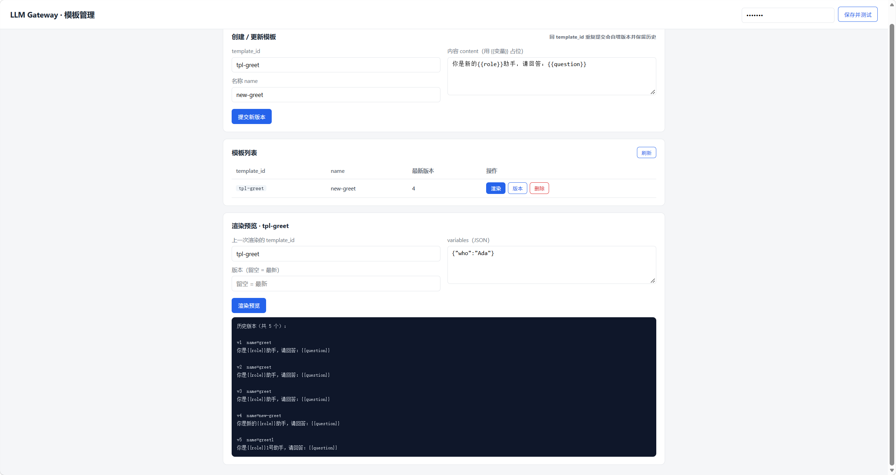

# LLM Gateway

OpenAI 兼容的自建 LLM 网关：智能路由、容错（retry/fallback/circuit breaker）、分层限流、SSE 流式、结构化输出校验与自动修复、用量/追踪/计费（恰好一次）。

规格依据：[docs/SPEC.md](../docs/SPEC.md)

## 快速开始

### Windows（PowerShell）

```powershell
# 1. 环境
python -m venv .venv
.\.venv\Scripts\Activate.ps1      # Windows 激活虚拟环境
pip install -r requirements-dev.txt

# 2. 配置（填入各 Provider Key；密钥不硬编码，均从环境变量读取）
#    复制 .env.example 为 .env 并填入真实 Key（.env 已被 .gitignore 忽略，勿提交）
$env:DEEPSEEK_API_KEY = "sk-your-key"   # 或临时设置单个变量

# 3. 启动（务必用虚拟环境解释器；系统 python 未装项目依赖，
#    会报 ModuleNotFoundError: No module named 'dotenv'）
.\.venv\Scripts\python.exe -m uvicorn app.main:app --host 0.0.0.0 --port 8000

# 4. 冒烟
curl.exe http://127.0.0.1:8000/healthz
curl.exe http://127.0.0.1:8000/readyz
curl.exe http://127.0.0.1:8000/metrics
curl.exe http://127.0.0.1:8000/v1/models -H "Authorization: Bearer sk-gateway-dev"
```

### Linux / macOS（Bash）

```bash
# 1. 环境
python -m venv .venv
source .venv/Scripts/activate         # Linux/macOS 激活虚拟环境
pip install -r requirements-dev.txt

# 2. 配置（填入各 Provider Key；密钥不硬编码，均从环境变量读取）
#    复制 .env.example 为 .env 并填入真实 Key（.env 已被 .gitignore 忽略，勿提交）
export DEEPSEEK_API_KEY="sk-your-key"   # 或临时设置单个变量

# 3. 启动（务必用虚拟环境解释器；系统 python 未装项目依赖，
#    会报 ModuleNotFoundError: No module named 'dotenv'）
.venv/Scripts/python -m uvicorn app.main:app --host 0.0.0.0 --port 8000

# 4. 冒烟
curl http://127.0.0.1:8000/healthz
curl http://127.0.0.1:8000/readyz
curl http://127.0.0.1:8000/metrics
curl http://127.0.0.1:8000/v1/models -H "Authorization: Bearer sk-gateway-dev"
```

## 调用示例

### 普通对话（非流式）

> **`model` 为可选字段。** 省略时网关在**全部已配置 Key 的候选**里按「成本 + 思考能力」
> 评分自动选路，**可能命中任意供应商**（如 qwen / kimi / anthropic），并非固定走
> deepseek。响应体的 `model` 字段会回显实际命中的模型。需要固定供应商/模型时，
> 请显式传 `model`，取值范围见 `config/gateway.yaml` 的 `available_models`
> （如 `deepseek-chat`、`qwen-max`）。下方示例均显式指定 `model`，便于复现。

**Windows（PowerShell）：** 多行命令用反引号 `` ` `` 续行；JSON Body 先写入临时文件再通过 `--data-binary` 发送（避免引号转义问题）。

```powershell
$body = '{"model":"deepseek-chat","messages":[{"role":"user","content":"1+1=?"}],"stream":false}' |
    Out-File "$env:TEMP\req.json" -Encoding ascii -NoNewline

curl.exe -X POST "http://127.0.0.1:8000/v1/chat/completions" `
  -H "Authorization: Bearer sk-gateway-dev" `
  -H "Content-Type: application/json" `
  --data-binary "@$env:TEMP\req.json"
```

**Linux / macOS / Git Bash：** 单引号包裹 JSON、`\` 续行，无需临时文件。
`-sS` 静默进度但保留错误输出（连接失败时可看到 `Failed to connect`），
`-i` 打印响应状态码与头（便于区分 401 invalid_auth / 200 OK 等）。
网关准入 Key 必须是 `.env` 中 `GATEWAY_API_KEYS` 内的值，如 `sk-gateway-dev`
（`sk-test` 等未在名单中的 Key 会返回 `401 invalid_auth`）。如需让测试 Key
（如 `sk-test`）也可用，可在 `.env` 中追加后重启服务：
`GATEWAY_API_KEYS=sk-gateway-dev,sk-gateway-test,sk-test`；生产环境不建议保留此类弱 Key (`sk-test`)。

```bash
curl -sS -i http://localhost:8000/v1/chat/completions \
  -H "Content-Type: application/json" \
  -H "Authorization: Bearer sk-gateway-dev" \
  -d '{"model":"deepseek-chat","messages":[{"role":"user","content":"hi"}],"max_tokens":64}'
```

不带 `model` 的自动选路对照（省略即交给网关决定）：

```bash
curl -sS http://localhost:8000/v1/chat/completions \
  -H "Content-Type: application/json" \
  -H "Authorization: Bearer sk-gateway-dev" \
  -d '{"messages":[{"role":"user","content":"hi"}],"max_tokens":64}'
```

响应体 `"model"` 即实际命中的模型名；需要固定时加回 `"model":"deepseek-chat"`。

### 采样参数（top_p / stop / penalties / seed）

除 `temperature` / `max_tokens` / `response_format` 外，请求体还支持以下**可选**采样参数。
均可不传；**不传时上游请求体与改造前完全一致**（严格向后兼容）：

| 字段 | 类型 | 说明 |
|---|---|---|
| `top_p` | float，0~1 | 核采样阈值 |
| `stop` | string 或 string[] | 停止序列，最多 4 条、不可为空串 |
| `presence_penalty` | float，-2~2 | 话题新鲜度惩罚 |
| `frequency_penalty` | float，-2~2 | 词频惩罚 |
| `seed` | integer | 尽力而为的可复现采样种子 |
| `logprobs` | boolean | 返回 token 的对数概率（**仅非流式生效**） |
| `top_logprobs` | integer，0~20 | 每个位置返回 top-N 候选；要求同时 `logprobs: true` |

```bash
curl -sS http://localhost:8000/v1/chat/completions \
  -H "Content-Type: application/json" \
  -H "Authorization: Bearer sk-gateway-dev" \
  -d '{"model":"deepseek-chat","messages":[{"role":"user","content":"hi"}],
        "top_p":0.9,"stop":["END"],"presence_penalty":0.1,"frequency_penalty":0.2,"seed":42}'
```

> **供应商差异**：OpenAI 兼容供应商原样透传全部字段；Anthropic 仅支持 `top_p` 与
> `stop`（映射为 `stop_sequences`，最多 4 条），`presence_penalty` /
> `frequency_penalty` / `seed` / `logprobs` / `top_logprobs` 会被显式忽略
> （仅记录 debug 日志，不返回错误）。
>
> `top_logprobs` 上限 20，且必须与 `logprobs: true` 同时使用，否则返回
> `400 invalid_request`（与 OpenAI 行为一致，同时避免响应体积被放大）。
> 未请求 logprobs 时，响应中仍保留 `choices[0].logprobs: null`（对齐 OpenAI 原生行为）。
> 流式请求暂不支持 logprobs，传入会被忽略。
>
> 其余未声明字段（如 `tools`、`n`）仍按「忽略」处理而非报错，避免破坏既有客户端；
> 因此这类参数**不会生效**，需要时请见「设计说明 → 后续升级方向」。

### logprobs：用途、边界与使用案例

`logprobs` 返回模型生成每个 token 时**采样前的条件概率**（对数形式）：
`p = exp(logprob)`，越接近 0 越确定。它描述"模型有多确信"，**不描述"答案是否正确"**。

**用途**

| 用途 | 做法 |
|---|---|
| 置信度门控 | `exp(logprob)` 低于阈值 → 转人工 / 追问澄清 / 降级到 fallback 模型 |
| 幻觉定位 | 找出低概率 token（通常落在数字、专有名词、日期处），按位置复核而非整段打回 |
| 提示词歧义检测 | 看 `top_logprobs` 前二候选差距；`< 1.0 nat`（概率差 < 2.7 倍）说明模型在摇摆 |
| 版本回归对比 | 同 prompt、同模型跨版本比较几何平均 logprob；**跨模型不可比**（tokenizer 切分不同） |

**边界**

- **高概率 ≠ 正确**：模型可以"自信地错"，不能替代 `response_format` 校验。
- **条件概率**：整段 `sum(logprob)` 随长度变负，比较长短回答时要用几何平均 `exp(-sum/len)`。
- **top-N 截断**：`top_logprobs` 只返回前 N 名，未列出的候选概率总和可能仍不小。
- **协议限制**：仅非流式生效（流式传入会被忽略）；Anthropic 显式忽略并返回 `logprobs: null`；
  部分 OpenAI 兼容供应商即便请求也不返回该字段，网关**原样透传、不伪造**。
- **结构差异**：`logprobs.content` 数组长度 ≠ 字符串长度，首 token 常带前导空格。
- **安全**：等于暴露模型输出分布（可用于蒸馏/提取），多租户对外时应纳入 Key 级能力白名单。

**使用案例**

```bash
curl -sS http://localhost:8000/v1/chat/completions \
  -H "Content-Type: application/json" \
  -H "Authorization: Bearer sk-gateway-dev" \
  -d '{"model":"deepseek-chat","messages":[{"role":"user","content":"Say hi"}],
        "logprobs":true,"top_logprobs":3}'
```

响应中的关键片段：

```json
"choices": [{
  "message": {"role": "assistant", "content": "Hi!"},
  "logprobs": {"content": [
    {"token": "Hi", "logprob": -0.002, "top_logprobs": [
      {"token": "Hi", "logprob": -0.002},
      {"token": "Hello", "logprob": -6.2}
    ]}
  ]}
}]
```

消费侧判定（`logprobs` 为 `null` 表示上游未返回，不能当 0 处理）：

```python
import math

lp = resp["choices"][0]["logprobs"]
if lp:
    items = lp["content"]
    min_p = min(math.exp(t["logprob"]) for t in items)      # 最犹豫的 token
    ppl = math.exp(-sum(t["logprob"] for t in items) / len(items))  # 跨长度可比的困惑度
    if min_p < 0.5 or ppl < 0.6:
        mark_for_review()          # 低置信 → 人工复核 / 转 fallback
```

| 指标 | 建议阈值 | 含义 |
|---|---|---|
| `min(exp(logprob))` | `< 0.5` 需复核 | 存在模型明显犹豫的 token |
| 几何平均概率 | `< 0.6` 低置信 | 整段输出不稳定 |
| 前二候选差距 | `< 1.0 nat` 有歧义 | 提示词可能含糊，而非模型能力问题 |

### 结构化输出（JSON Schema 校验 + 自动修复）

**Windows（PowerShell）：**

```powershell
$body = '{"model":"deepseek-chat","messages":[{"role":"user","content":"解析用户意图"}],
         "response_format":{"type":"json_schema","json_schema":{"name":"intent","schema":{"type":"object","properties":{"intent":{"type":"string"}},"required":["intent"]}}}}' |
    Out-File "$env:TEMP\req.json" -Encoding ascii -NoNewline

curl.exe -X POST "http://127.0.0.1:8000/v1/chat/completions" `
  -H "Authorization: Bearer sk-gateway-dev" `
  -H "Content-Type: application/json" `
  --data-binary "@$env:TEMP\req.json"
```

**Linux / macOS（Bash）：** body 通过 heredoc 走 stdin（`--data-binary @-`），
规避 Windows Git Bash 把命令行参数中的中文按 GBK 编码、导致服务端 JSON 解析失败。

```bash
curl -sS -X POST http://localhost:8000/v1/chat/completions \
  -H "Authorization: Bearer sk-gateway-dev" \
  -H "Content-Type: application/json" \
  --data-binary @- <<'JSON'
{"model":"deepseek-chat",
 "messages":[{"role":"user","content":"解析用户意图"}],
 "response_format":{"type":"json_schema","json_schema":{"name":"intent",
   "schema":{"type":"object","properties":{"intent":{"type":"string"}},"required":["intent"]}}}}
JSON
```

### 流式输出（Server-Sent Events）

**Windows（PowerShell）：** Windows PowerShell 中 `curl` 是 `Invoke-WebRequest` 的别名，必须使用 `curl.exe` 才能支持 `-H`/`--data-binary` 等参数；流式场景还需加 `-N`（`--no-buffer`）关闭缓冲，才能看到逐行输出的效果。幂等写法：先把 JSON 写入临时文件再发送，避免引号转义问题。

```powershell
$json = '{"model":"deepseek-chat","messages":[{"role":"user","content":"数到5"}],"stream":true}'

# PowerShell 5.1 的 -Encoding UTF8 会写入 BOM（非法 JSON 前导字节）；
# 用 .NET 写成无 BOM 的 UTF-8，PS 5.1 / PS 7 行为一致
[System.IO.File]::WriteAllText("$env:TEMP\req.json", $json, (New-Object System.Text.UTF8Encoding($false)))

curl.exe -s -N -X POST "http://127.0.0.1:8000/v1/chat/completions" `
  -H "Authorization: Bearer sk-gateway-dev" `
  -H "Content-Type: application/json" `
  --data-binary "@$env:TEMP\req.json"
```

**Linux / macOS / Git Bash：** `-N` 用于关闭缓冲，逐行输出 SSE 事件。body 走 stdin，
避免中文参数被 shell 按 GBK 转码：

```bash
curl -s -N -X POST "http://127.0.0.1:8000/v1/chat/completions" \
  -H "Authorization: Bearer sk-gateway-dev" \
  -H "Content-Type: application/json" \
  --data-binary @- <<'JSON'
{"model":"deepseek-chat","messages":[{"role":"user","content":"数到5"}],"stream":true}
JSON
```

> **Windows Git Bash 必读**：不要写成 `-d '...中文...'`。中文 Windows 下该参数会按
> GBK/CP936 传给 curl，服务端收到非法 UTF-8，在进入业务逻辑前就返回
> `400 {"detail":"There was an error parsing the body"}`（与流式输出无关）。
> 请使用上面的 stdin 写法，或先把 JSON 存为 UTF-8 文件再 `--data-binary @req.json`。

响应为多条 `data: {...}` 事件，末行 `data: [DONE]` 表示结束。也可直接使用 Swagger UI
交互式测试：浏览器打开 `http://127.0.0.1:8000/docs`。

### 流式 + 结构化输出（validation 事件契约）

当请求同时满足 `stream:true` 且携带 `response_format`（结构化输出）时，网关会在正常
chunk 事件之后、`[DONE]` 之前追加**一条** `validation` 事件，供调用方判断整段流式输出
是否通过 schema 校验。

| 字段 | 值 | 说明 |
|---|---|---|
| `type` | `"validation"` | 事件类型标识 |
| `status` | `"ok"` \| `"error"` | 累积内容是否通过 schema 校验 |
| `error` | `null` \| string | 失败时为 validator 的错误描述 |
| `choices` | `[]` | 恒为空数组（非续写内容） |
| `id` / `object` / `created` / `model` | 与其它 chunk 一致 | 便于按唯一 id 关联同一次请求 |

事件序列（结构化输出流式）：

```text
data: {"id":"chatcmpl-...","object":"chat.completion.chunk","model":"deepseek-chat","choices":[{"index":0,"delta":{"content":"{\"intent\":"},"finish_reason":null}]}
data: {"id":"chatcmpl-...","object":"chat.completion.chunk","model":"deepseek-chat","choices":[{"index":0,"delta":{"content":"\"buy\"}"},"finish_reason":"stop"}]}
data: {"id":"chatcmpl-...","object":"chat.completion.chunk","model":"deepseek-chat","type":"validation","status":"ok","error":null,"choices":[]}
data: [DONE]
```

> 普通对话流（未携带 `response_format`）**不会**发送 `validation` 事件，事件序列与 OpenAI 官方一致。

**语义与取舍：** 流式下 delta 已逐块透传给客户端，因此校验只能**事后进行、无法自动修复**；
`status:"error"` 表示整段拼接内容不合 schema，调用方应丢弃本次结果或按业务重试。非流式路径
则在返回前校验并尝试自动修复，失败会重试/fallback——两者行为不同，需分别处理。

**示例（Bash / Git Bash）：** body 通过 heredoc 走 stdin（`--data-binary @-`），
避免 Windows 控制台把参数中的中文转成 GBK 导致服务端 JSON 解析失败。

```bash
curl -sS -N http://localhost:8000/v1/chat/completions \
  -H "Content-Type: application/json" \
  -H "Authorization: Bearer sk-gateway-dev" \
  --data-binary @- <<'JSON'
{"model":"deepseek-chat",
 "messages":[{"role":"user","content":"解析用户意图，返回 JSON"}],
 "stream":true,
 "response_format":{"type":"json_schema","json_schema":{"name":"intent",
   "schema":{"type":"object","properties":{"intent":{"type":"string"}},"required":["intent"]}}}}
JSON
```

### 模板管理 HTTP 端点（/v1/templates）

模板管理原本仅 CLI 可用（`python -m cli.gateway_cli templates ...`），现已暴露为
REST 端点，复用网关统一 Bearer 鉴权（默认 key 见 `config/gateway.yaml` 的 `api_keys`；
若设置了 `GATEWAY_API_KEYS` 环境变量，则以环境变量为准，YAML 中的 key 被忽略）。

语义约定：
- 每次 `POST` upsert 自动自增 `version` 并保留历史版本；
- **模板不存在 → 404 `not_found`**（GET/DELETE/render/chat 引用均一致）；
- **输入类错误 → 400**：缺模板变量 `prompt_missing_vars`、模板语法错误/参数校验失败 `invalid_request`。

| 方法 | 路径 | 说明 |
|---|---|---|
| GET | `/v1/templates` | 列出所有模板（每个 template_id 的最新版本） |
| GET | `/v1/templates/{id}` | 查询模板，`?version=N` 取指定版本，缺省最新 |
| GET | `/v1/templates/{id}/versions` | 列出全部历史版本（升序） |
| POST | `/v1/templates` | 新增版本（自增 version、保留历史） |
| POST | `/v1/templates/{id}/render` | 用变量预览渲染结果（不调用上游） |
| DELETE | `/v1/templates/{id}` | 删除；`?version=N` 删单版本，缺省删全部（响应含 `deleted` 数量） |

**网页管理界面：** 网关内置了一个零依赖的单文件管理页（增删改查 + 版本查看 +
渲染预览），由网关同源提供，浏览器打开即用、无跨域问题：

```
http://127.0.0.1:8000/ui/templates        # 友好短路径
http://127.0.0.1:8000/ui/templates.html   # 等价（静态挂载）
```

页面顶部填入网关 API Key（须为 `.env` 中 `GATEWAY_API_KEYS` 内的值，如
`sk-gateway-dev`；`sk-test` 等未在名单中的 Key 会返回 `401 invalid_auth`）后点
「保存并测试」，后续所有操作自动携带 `Authorization: Bearer ...` 头。Key 仅保存在
浏览器 `localStorage`，数据操作仍受 `/v1/templates` 统一鉴权保护。HTML 本身可匿名
访问，页面源码见 `app/static/templates.html`。



**Windows（PowerShell）：** 先写临时文件再 `--data-binary` 发送，**不受 Git Bash 的 GBK 传参问题影响**，
因为正文不经过命令行参数；但文件必须是 **UTF-8 且不带 BOM**：

- PS 5.1 的 `-Encoding UTF8` 会写 BOM（首字节 `239,187,191`），`-Encoding ascii` 会破坏中文；
- 故统一用 `[System.IO.File]::WriteAllText(..., UTF8Encoding($false))`（PS 7+ 也可用 `-Encoding utf8NoBOM`）；
- 自检：文件首字节应为 `123`（即 `{`）。若是 `239` 开头，说明带了 BOM，会得到
  `400 {"detail":"There was an error parsing the body"}`。

验证通过时，渲染预览应返回 `HTTP 200` 与 `{"template_id":"tpl-greet","rendered":"你是销售助手，请回答：报价策略"}`。

```powershell
# 1) 创建/更新模板（返回新版本号；再次调用同一 id 会自增 version）
$json = '{"template_id":"tpl-greet","name":"greet","content":"你是{{role}}助手，请回答：{{question}}"}'
[System.IO.File]::WriteAllText("$env:TEMP\tpl.json", $json, (New-Object System.Text.UTF8Encoding($false)))

curl.exe -X POST "http://127.0.0.1:8000/v1/templates" `
  -H "Authorization: Bearer sk-gateway-dev" `
  -H "Content-Type: application/json" `
  --data-binary "@$env:TEMP\tpl.json"

# 2) 列出所有模板
curl.exe http://127.0.0.1:8000/v1/templates -H "Authorization: Bearer sk-gateway-dev"

# 3) 查询模板（缺省最新；?version=1 取历史版本）
curl.exe http://127.0.0.1:8000/v1/templates/tpl-greet -H "Authorization: Bearer sk-gateway-dev"
curl.exe "http://127.0.0.1:8000/v1/templates/tpl-greet?version=1" -H "Authorization: Bearer sk-gateway-dev"

# 4) 列出历史版本
curl.exe http://127.0.0.1:8000/v1/templates/tpl-greet/versions -H "Authorization: Bearer sk-gateway-dev"

# 5) 渲染预览（不调用上游，适合调试模板）
$json = '{"variables":{"role":"销售","question":"报价策略"}}'
[System.IO.File]::WriteAllText("$env:TEMP\render.json", $json, (New-Object System.Text.UTF8Encoding($false)))

curl.exe -X POST "http://127.0.0.1:8000/v1/templates/tpl-greet/render" `
  -H "Authorization: Bearer sk-gateway-dev" `
  -H "Content-Type: application/json" `
  --data-binary "@$env:TEMP\render.json"

# 5b) 排查接口本身（纯 ASCII 可直接用 -d，不依赖文件编码）
curl.exe -X POST "http://127.0.0.1:8000/v1/templates/tpl-greet/render" `
  -H "Authorization: Bearer sk-gateway-dev" `
  -H "Content-Type: application/json" `
  -d '{\"variables\":{\"role\":\"sales\",\"question\":\"pricing\"}}'

# 5c) 清理临时文件
Remove-Item "$env:TEMP\tpl.json","$env:TEMP\render.json" -ErrorAction SilentlyContinue

# 6) 删除（?version=1 删指定版本；缺省删全部）
curl.exe -X DELETE "http://127.0.0.1:8000/v1/templates/tpl-greet?version=1" `
  -H "Authorization: Bearer sk-gateway-dev"
curl.exe -X DELETE http://127.0.0.1:8000/v1/templates/tpl-greet -H "Authorization: Bearer sk-gateway-dev"
```

**Linux / macOS（Bash）：** body 通过 heredoc 走 stdin。
若在 **Windows Git Bash** 中直接把中文写进 `-d '...'`，命令行参数会被按 GBK 编码传入，
服务端收到非 UTF-8 字节 → `400 {"detail":"There was an error parsing the body"}`。

```bash
# 创建/更新
curl -X POST "http://127.0.0.1:8000/v1/templates" \
  -H "Authorization: Bearer sk-gateway-dev" \
  -H "Content-Type: application/json" \
  --data-binary @- <<'JSON'
{"template_id":"tpl-greet","name":"greet","content":"你是{{role}}助手，请回答：{{question}}"}
JSON
```

```bash
# 渲染预览
curl -X POST "http://127.0.0.1:8000/v1/templates/tpl-greet/render" \
  -H "Authorization: Bearer sk-gateway-dev" \
  -H "Content-Type: application/json" \
  --data-binary @- <<'JSON'
{"variables":{"role":"销售","question":"报价策略"}}
JSON
```

```bash
# 列出 / 查询 / 删除（无 body，不受编码影响）
curl http://127.0.0.1:8000/v1/templates -H "Authorization: Bearer sk-gateway-dev"
curl "http://127.0.0.1:8000/v1/templates/tpl-greet?version=1" -H "Authorization: Bearer sk-gateway-dev"
curl -X DELETE "http://127.0.0.1:8000/v1/templates/tpl-greet?version=1" -H "Authorization: Bearer sk-gateway-dev"
```

> 纯 ASCII 的 body（如 `{"variables":{"role":"sales"}}`）用 `-d '...'` 在 Git Bash 中可直接使用；
> 含中文时统一改用 `--data-binary @- <<'JSON'` 或临时文件方式。

聊天中引用模板：在 `POST /v1/chat/completions` 请求体中通过扩展字段
`template_id` / `template_version`（缺省最新）/ `template_vars` 注入，渲染结果作为
system 消息参与对话：

```json
{"model":"deepseek-chat",
 "messages":[{"role":"user","content":"hello"}],
 "template_id":"tpl-greet",
 "template_vars":{"role":"销售","question":"报价策略"}}
```

与 CLI 的分工：**HTTP 端点适合在线管理**（需要网关运行中，走统一 Bearer 鉴权）；
**CLI 适合离线运维**（无需启动网关，直接操作 SQLite）。CLI 用法见
「CLI 运维 → 模板管理（CLI）」。

## 测试

`tests/` 内的测试均为 **E2E（全 mock）+ 单测**：通过 `conftest.py` 启动一个模拟的
LLM 上游服务（`tests/mock_upstream.py`），并为每个用例创建指向该 mock 的网关实例。
**无需真实 Provider API Key，不访问外部网络。**

> 注意：请务必使用虚拟环境中的解释器（Windows 为 `.\.venv\Scripts\python.exe`，
> Linux/macOS 为 `.venv/bin/python`），不要用系统 `python`（系统解释器未安装
> pytest，会报 `No module named pytest`）。

运行全部测试：

```powershell
.\.venv\Scripts\python.exe -m pytest tests -v
```

只运行某个文件 / 某个用例：

```powershell
.\.venv\Scripts\python.exe -m pytest tests/test_api.py -v
.\.venv\Scripts\python.exe -m pytest tests/test_rate_limiter.py::test_token_bucket_capacity -v
```

带覆盖率：

```powershell
.\.venv\Scripts\python.exe -m pytest tests -v --cov=app --cov-report=term
```

### 常见问题：上游请求全部返回 502

若所有发往 mock 上游的用例（`test_chat_completion_nonstream` 等）都报
`Upstream error 502`，通常是 **Windows 系统代理**在作祟：httpx 默认 `trust_env=True`
会把对本地 `127.0.0.1` 端口的上游请求转发给系统代理，代理返回 502。

修复方式：网关上行的 HTTP 客户端禁用系统代理（`SharedHttpClientPool` 中已处理，
见 `app/core/http_client_pool.py`）：

```python
httpx.AsyncClient(timeout=timeout, limits=limits, trust_env=False)
```

### 常见问题：`{"detail":"There was an error parsing the body"}`

该 400 由 FastAPI 解析 body 阶段抛出，说明服务端收到的**不是合法 UTF-8 JSON**，
与鉴权、schema 无关（因此不会返回 `invalid_auth` / `invalid_request`）。
最常见原因：在中文 Windows 的 Git Bash / PowerShell 里用 `curl -d '...中文...'`，
命令行参数被按 ANSI 代码页（GBK/CP936）传给 curl，body 变成非法 UTF-8。

规避方式（任选其一）：

1. body 走 stdin：`curl ... --data-binary @- <<'JSON' ... JSON`（推荐，见上方示例）；
2. 先把 JSON 写成**无 BOM 的 UTF-8** 文件，再 `--data-binary @req.json`（PS 5.1 的 `-Encoding UTF8` 会带 BOM，推荐用 .NET `WriteAllText`）；
3. 控制台切 UTF-8 代码页（`chcp.com 65001`），或示例内容改用 ASCII。

## 可观测性与健康检查

网关提供三个运维端点，均**无需鉴权、低成本**（`/metrics` 不进入 OpenAPI schema）：

| 端点 | 语义 | 返回 |
|---|---|---|
| `GET /healthz` | **存活**探针：只证明进程在运行，不访问任何依赖 | `200` + `config_version` / `providers` |
| `GET /readyz` | **就绪**探针：校验配置已加载、SQLite 可读写、连接池已初始化 | `200` / `503` + 逐项 `checks` |
| `GET /metrics` | Prometheus 文本格式指标 | `text/plain; version=0.0.4` |

两者分工：容器 `HEALTHCHECK` 用 `/healthz`（避免 SQLite 抖动误杀容器）；负载均衡 /
外部探针用 `/readyz`。Provider 缺 Key 只在 `providers.missing_key` 中降级提示，
**不判定为 503**（属配置问题而非进程故障）。

```bash
curl -sS http://localhost:8000/readyz
# {"status":"ok","checks":{"config":{"ok":true,"version":1},"storage":{"ok":true},
#  "http_pool":{"ok":true},"providers":{"ok":false,"missing_key":["openai"]}}}

curl -sS http://localhost:8000/metrics
```

暴露的指标：

| 指标 | 类型 | 含义 |
|---|---|---|
| `llm_gateway_requests_total{endpoint,status}` | counter | 请求量；`status` 为 `success` 或错误码（如 `rate_limit_exceeded`） |
| `llm_gateway_request_duration_seconds_sum/_count{endpoint}` | summary | 处理耗时；流式请求记录「直到响应开始」的耗时 |
| `llm_gateway_rate_limit_rejected_total` | counter | 被限流拒绝的请求数 |
| `llm_gateway_upstream_attempts_total` | counter | 上游调用尝试次数（含重试与降级） |
| `llm_gateway_config_version` | gauge | 当前生效的配置版本号 |
| `llm_gateway_uptime_seconds` | gauge | 进程运行时长 |
| `llm_gateway_build_info{version}` | gauge | 构建版本（恒为 1） |

> 指标为**每进程视角**：多 worker 部署时各 worker 独立计数，`/metrics` 每次只命中单个
> worker；跨进程的精确历史数据仍以 SQLite（`usage_metrics` / `daily_aggregates`）与 CLI 为准。

### 指标只读查询端点（/v1/admin）

与 CLI 查询同一份 SQLite 数据，但可被脚本/看板直接调用。**需要 Bearer 鉴权**，
纯只读，查询规模有硬上限，不提供任何写操作。

| 端点 | 说明 | 关键参数 |
|---|---|---|
| `GET /v1/admin/summary` | 累计概览（请求数 / token / 成本 / 平均时延 / 错误数） | — |
| `GET /v1/admin/traces` | 最近追踪记录（不含 prompt/response 原文） | `limit`(1~200，默认 20)、`status` |
| `GET /v1/admin/daily` | 按天聚合的用量与成本 | `days`(1~90，默认 7)、`provider` |

```bash
curl -sS http://localhost:8000/v1/admin/summary -H "Authorization: Bearer sk-gateway-dev"
curl -sS "http://localhost:8000/v1/admin/traces?limit=10&status=error" -H "Authorization: Bearer sk-gateway-dev"
curl -sS "http://localhost:8000/v1/admin/daily?days=7" -H "Authorization: Bearer sk-gateway-dev"
```

超出上限的参数（如 `limit=99999`）会直接返回 `400 invalid_request`，不做静默截断。

### 计费与定价（prompt/completion 分价）

供应商支持按 prompt / completion 分别定价（两者单价通常相差数倍）：

```yaml
providers:
  deepseek:
    cost_prompt_per_million_tokens: 0.5
    cost_completion_per_million_tokens: 2.0
```

- 配置了分价时，**计费、预算预检、路由加权价**均使用分价；只写 `cost_per_million_tokens`
  （单一均价）时，两价回退为该值，兼容旧配置。
- 单次成本 = `prompt_tokens/1e6 × prompt单价 + completion_tokens/1e6 × completion单价`，
  落库到 `usage_metrics.cost_usd`，并累计进 `daily_aggregates`。
- 三个价格字段全部缺失时会打印 warning 并按 `$1/M` 计费（避免静默按 0 计费）。
- 上游未返回 usage 的请求按估算 token 记录，并标记 `estimated=1`、`cost_usd=0`，
  因此日报成本可能偏低；精确账单以返回 usage 的请求为准。

`daily`（CLI 与 `/v1/admin/daily`）已按 `prompt_tokens` / `completion_tokens` 分列累计。

## CLI 运维

### 用量 / 追踪 / 熔断查询

**Windows（PowerShell）：**

```powershell
.\.venv\Scripts\python.exe -m cli.gateway_cli summary
.\.venv\Scripts\python.exe -m cli.gateway_cli daily --days 7
.\.venv\Scripts\python.exe -m cli.gateway_cli traces --status error
.\.venv\Scripts\python.exe -m cli.gateway_cli circuit
```

**Linux / macOS（Bash）：**

```bash
.venv/Scripts/python -m cli.gateway_cli summary
.venv/Scripts/python -m cli.gateway_cli daily --days 7
.venv/Scripts/python -m cli.gateway_cli traces --status error
.venv/Scripts/python -m cli.gateway_cli circuit
```

### 模板管理（CLI）

模板管理也可全部走 CLI（与「调用示例 → 模板管理 HTTP 端点」操作同一 SQLite 存储，
无需启动网关服务、无需鉴权头，适合脚本化/离线运维）。子命令
`list / get / upsert / delete`，行为与 HTTP 端点一致：upsert 自增 version 保留历史，
`--version` 缺省取最新或删除全部。

**Windows（PowerShell）：**

```powershell
# 列出所有模板（每个 template_id 的最新版本）
.\.venv\Scripts\python.exe -m cli.gateway_cli templates list

# 查询模板（--version 缺省取最新版本）
.\.venv\Scripts\python.exe -m cli.gateway_cli templates get tpl-greet
.\.venv\Scripts\python.exe -m cli.gateway_cli templates get tpl-greet --version 1

# 新增版本（自增 version、保留历史）
.\.venv\Scripts\python.exe -m cli.gateway_cli templates upsert --id tpl-greet --name greet --content "你是{{role}}助手"

# 删除（--version 删除指定版本；缺省删除全部版本）
.\.venv\Scripts\python.exe -m cli.gateway_cli templates delete tpl-greet --version 1
.\.venv\Scripts\python.exe -m cli.gateway_cli templates delete tpl-greet
```

**Linux / macOS（Bash）：**

```bash
.venv/Scripts/python -m cli.gateway_cli templates list
.venv/Scripts/python -m cli.gateway_cli templates get tpl-greet --version 1
.venv/Scripts/python -m cli.gateway_cli templates upsert --id tpl-greet --name greet --content "你是{{role}}助手"
.venv/Scripts/python -m cli.gateway_cli templates delete tpl-greet
```

对应 HTTP 端点见「调用示例 → 模板管理 HTTP 端点」。

## 设计说明：协议选型（Chat Completions vs Responses API）

本项目上游统一走 **OpenAI Chat Completions 协议**（`POST /v1/chat/completions`），
而非 OpenAI 的 **Responses API**（`POST /v1/responses`）。原因：

- **多供应商统一**：网关覆盖 OpenAI、DeepSeek、Kimi、Qwen、Ollama。Chat Completions
  是事实上的兼容基线，上述供应商均实现该协议；Responses API 目前仅 OpenAI 官方支持，
  采用它会破坏「一个适配器通吃全部供应商」的架构对称性（路由/重试/熔断/计费都要分叉）。
- **成熟稳定**：工具调用、结构化输出（`response_format`）、SSE 流式在该协议上均有
  完善且一致的支持，候选切换时各供应商行为对齐。
- **生态工具链**：主流 SDK 与第三方网关均以 Chat Completions 为兼容目标。

代价是放弃了 Responses API 的服务端状态续接、内置工具（web search / file search /
code interpreter）、推理摘要等新特性——这些能力需网关自行编排。若未来某供应商需要
`web_search` 等内置工具，可在 openai-compat 适配器内演进，无需切换协议基线：

1. **透传工具参数**：在 `_build_body()` 中新增 `tools`/`tool_choice` 字段透传，
   把网关侧请求体中的工具声明映射到上游 Chat Completions 的 `tools` 参数；
   `response_format` 等既有约束字段保持不变。
2. **工具调用结果回传**：上游返回 `tool_calls` 增量时，适配器在 `StreamEvent`
   上增加工具调用事件类型，经现有流式通道原样转发；非流式则在 `AdapterResult`
   中携带 `tool_calls`。
3. **能力感知路由**：注册表为供应商标记 `capabilities`，路由层在候选过滤时跳过
   不支持目标工具的供应商，保证 fallback 链路不会回落到不支持的供应商。
4. **本地模拟兜底**：对无上游内置工具的供应商，可在网关侧用「声明工具 → 模型生成
   `tool_calls` → 网关执行本地搜索 → 结果注入下一轮 messages」的函数调用模式近似，
   在业务层与内置工具对齐。

如此既有供应商不受影响，新增能力只收敛在适配器与路由的少数几个点。

## 验收记录：真实双供应商模型 Fallback

演示环境配置：deepseek 的 `api_base_url` 临时指向不可达地址（用于强制触发重试→fallback），
kimi 未配置 `KIMI_API_KEY`，qwen 配置真实 Key。请求未指定 `model`，触发完整候选链。

请求（网关鉴权 key 为测试 key，此处占位）：

```bash
curl.exe -s -X POST "http://127.0.0.1:8000/v1/chat/completions" `
  -H "Authorization: Bearer <gateway-key>" `
  -H "Content-Type: application/json" `
  --data-binary "@$env:TEMP\req.json"
```

请求体：`{"messages":[{"role":"user","content":"1+1=?"}],"stream":false}`

响应（摘录，供应商 Key 不出现于任何输出）：

```json
{
  "id": "chatcmpl-84180ab635874d3e962fcf34",
  "object": "chat.completion",
  "model": "qwen-max",
  "choices": [{"index": 0, "message": {"role": "assistant", "content": "1+1=2"},
               "finish_reason": "stop"}],
  "usage": {"prompt_tokens": 12, "completion_tokens": 5, "total_tokens": 17}
}
```

实际链路与旁证（`cli.gateway_cli` 查询）：

- **deepseek**：上游不可达，按重试策略消耗尝试后失败（`upstream_error`，已记录为 error trace）。
- **kimi**：未配置 Key，被路由阶段按 `has_api_key()` 剔除（不产生非法请求头、不重试、不计熔断失败）。
- **qwen**：200 OK 命中，trace 记录 `provider=qwen / model=qwen-max`，响应 id 为 24 位
  无连字符格式（`chatcmpl-<24 hex>`）。

```text
$ python -m cli.gateway_cli traces --status error
{ ... "status": "error", "error_code": "upstream_error", ... }   # deepseek 失败链路
$ python -m cli.gateway_cli traces --status success
{ ... "provider": "qwen", "model": "qwen-max", "status": "success", ... }
$ python -m cli.gateway_cli summary
requests           29
prompt_tokens      531
completion_tokens  510
total_tokens       1041
total_cost         $0.0011
avg_latency_ms     2710.6
avg_ttft_ms        677.3
providers          2
errors             16
```

该记录同时验证：候选链评分/重试/熔断过滤、trace 状态列与 payload 一致性、CLI 状态过滤正确。

## 目录结构

```
app/
  api/chat.py          # /v1/chat/completions 管道
  api/templates.py     # /v1/templates 模板管理 HTTP 端点
  api/admin.py         # /v1/admin 指标只读查询端点（summary/traces/daily）
  static/templates.html# /ui/templates 单文件模板管理页
  core/                # 鉴权/限流/路由/熔断/取消/连接池/渲染/校验/配置/指标
  adapters/            # openai-compat / anthropic 适配器 + 注册表
  storage/             # MetricsStore（SQLite WAL + 幂等计费）
  main.py              # FastAPI 入口 + 生命周期 + 配置热更新 + /healthz /readyz /metrics
cli/gateway_cli.py     # 运维查询 CLI
config/gateway.yaml    # 配置（支持热更新）
docker/                # Dockerfile（H3 待评审）
tests/                 # E2E（全 mock）+ 单测
```
