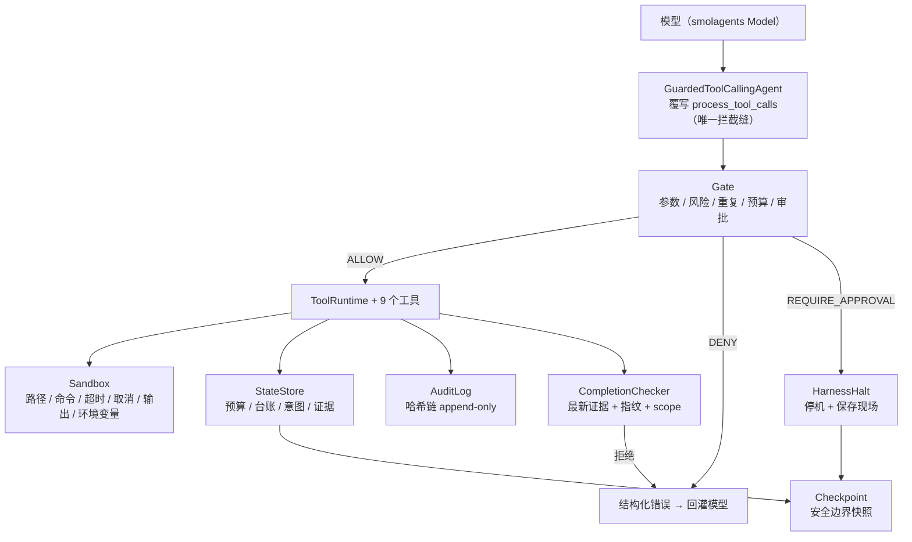
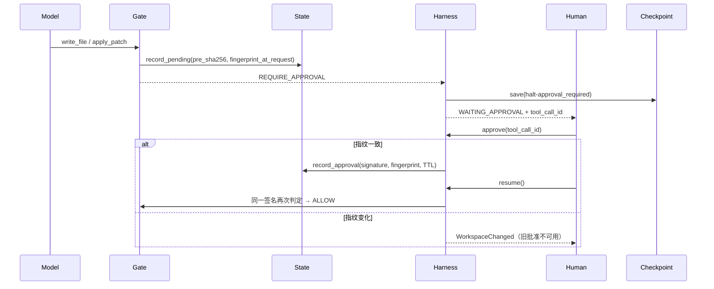
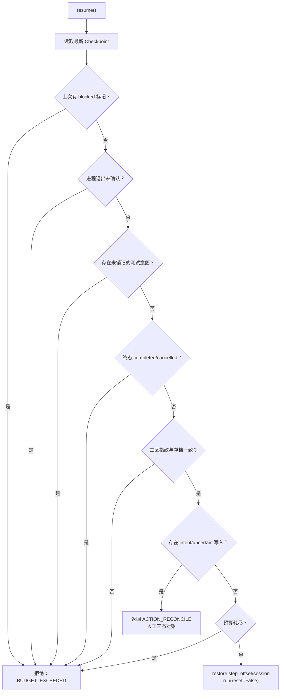

# Guarded Coding Harness 规格计划书（SPEC）

## 0. 文档信息

| 项目 | 内容 |
|---|---|
| 文档编号 | SPEC-GCH-001 |
| 版本 | v1.0 |
| 状态 | 已定稿（待实现与测试验证） |
| 日期 | 2026-11-07 |
| 适用项目 | `c:\projet\homework\ch3\guarded_coding_harness` |
| 上游依据 | [`docs/q3.md`](./q3.md)、[`docs/第三章_学习笔记_知识点与逻辑框架.md`](./第三章_学习笔记_知识点与逻辑框架.md) |
| 读者 | 实现工程师、测试工程师、安全与审计评审人 |
| 内核依赖 | smolagents（`ToolCallingAgent`），**不修改其源码** |

### 0.1 变更记录

| 版本 | 日期 | 变更 |
|---|---|---|
| v1.0 | 2026-11-07 | 首次定稿：三态对账扩展到测试运行、取消落执行层、暂停/取消语义分离、审批指纹绑定、恢复优先级固化 |

### 0.2 术语

| 术语 | 含义 |
|---|---|
| Run | 一次从 `agent_start` 到停止的完整任务执行 |
| Turn | 一次模型响应及其提出的 0~N 个工具调用 |
| Tool Call | 模型提出的单个工具调用，带唯一 `tool_call_id` |
| Gate | 所有 Tool Call 的唯一判定入口 |
| Halt | 主动停机（非重试性错误），穿透 Agent Loop 并保存现场 |
| 三态对账 | 对结果不明的写入/测试，判定 `EXECUTED / NOT_EXECUTED / UNCERTAIN` |
| 指纹 | `fp:v1:sha256(canonical_json(sorted[(relpath, sha256)]))`，排除 `artifacts/`、`.harness/`、`.git/`、缓存目录 |
| 证据（Evidence） | 带 scope、seq、指纹与版本的验收事实 |

---

## 1. Problem Statement（问题陈述）

自主 Coding Agent 在一次长任务中会反复出现四类"看起来完成了"的失效：

1. **完成声明绕过交付物**：模型直接回答"已修复"，但没有当前版本的测试证据。
2. **旧证据复用**：测试通过后又改了源码，完成检查仍拿旧结果放行。
3. **重复副作用**：恢复或重试时重复执行同一写入；或第二次被拒后，调用方拿不到第一次的结果回执。
4. **取消只停界面**：取消信号没有落到真实执行器，测试子进程仍在跑；进程是否退出不明时又立刻开启下一次运行。
5. **结果不明被当作失败重放**：写入已经落盘但回执丢失，恢复时又重放一次，造成重复修改。

这些问题的共同根源是：**一次工具执行产生的事实，没有同时、正确地到达模型上下文、业务状态、审批/审计、完成检查四个读者**。

## 2. Solution（解决方案）

在 `ToolCallingAgent` 之上加一层 **Guarded Coding Harness**，模型继续负责决策，程序负责门禁、执行边界、状态、审计、恢复和最终验收：

- **单一入口**：所有工具调用先经过 Gate，再进入执行器；拒绝的动作不触达 handler。
- **单一拦截缝**：只覆写 `process_tool_calls`，通过 `yield from super()` 复用内核执行段，零改 smolagents 源码。
- **混合停机协议**：可回灌错误用 `AgentToolCallError` 返回给模型继续；不可继续的状态用 `HarnessHalt` 停机并保存现场。
- **三态对账**：写入与测试运行都在执行前登记意图，拿到明确结果才销记；结果不明时阻断恢复，等待核对。
- **取消落执行层**：取消信号直达沙箱子进程组，确认进程退出后才允许同一工作区再次运行。
- **完成契约**：基于当前指纹下的最新有效证据，而不是模型自述或历史成功。

---

## 3. 目标、成功标准与非目标

### 3.1 目标

| 编号 | 目标 |
|---|---|
| O1 | 所有 Tool Call 只有一个入口，业务规则不散落在 handler |
| O2 | 拒绝动作有结构化错误、原 `tool_call_id`、审计留痕，handler 执行次数为 0 |
| O3 | 文件、命令、超时、输出、环境变量五类边界真实生效 |
| O4 | 写入与测试运行可三态对账，结果不明不得自动重放 |
| O5 | 新进程可恢复：进度、证据、预算、待审批动作不丢、不重复 |
| O6 | 取消与暂停语义分离，取消能真实终止进程组 |
| O7 | 审计可按 `run_id` 与 `tool_call_id` 还原完整决策链 |
| O8 | `pytest -q` 全绿，不依赖真实模型即可复现全部边界 |

### 3.2 成功标准（对应 q3 核心验收）

| 编号 | 场景 | 通过标准 |
|---|---|---|
| G1 | 参数缺字段或类型错误 | 明确错误，handler 调用次数 0 |
| G2 | 连续三次相同工具与参数 | 第三次执行前拦截，handler 只执行 2 次 |
| G3 | 未审批的写操作 | 进入 `WAITING_APPROVAL`，目标文件不变 |
| G4 | 审批后重复执行同一调用 | 第一次只执行一次，第二次拒绝，不重复写入 |
| S1 | `artifacts/../../.env` 路径逃逸 | Sandbox 拒绝，handler 不执行 |
| S2 | 软链接逃逸或敏感目录访问 | 真实落点校验后拒绝，审计留痕 |
| S3 | `run_test` 配置外命令 | 命令不在允许范围时不执行 |
| S4 | 命令超时或用户取消 | 进程组真实终止，不是只停止等待 |
| C1 | 每个安全步骤后保存 Checkpoint | 含 run、step、计划、证据、预算、待审批 |
| C2 | 写入完成后结果未保存时恢复 | 标记 `UNKNOWN_RESULT`，不得自动重放 |
| C3 | 正常中断后换进程恢复 | 找回进度，已完成写入不重复，计数不清零 |
| C4 | 恢复时工作区已变化 | 旧证据/旧审批失效，停止并等待核对 |
| A1 | 查看被拒绝调用 | 审计含 rule、decision、actor、toolCallId |
| A2 | 查看完整任务 | 关联 Gate、Sandbox、State、Approval 与执行结果 |
| H1 | 模型说完成但无交付物 | final answer 被拒绝，不能进入完成态 |
| H2 | 测试通过后又修改源码 | 旧测试证据失效，必须重跑当前版本 |
| H3 | 达到最大轮数或预算 | 以明确 `StopReason` 停止，不伪装成功 |
| T1 | 运行完整测试集 | 所有 P0 场景确定性可重复通过 |
| T2 | 真实模型跑通一类任务（P1） | 产物、Diff、测试记录与审计互相印证 |

### 3.3 非目标

- 不重写、不修改 smolagents 内核源码。
- 不实现 Docker/VM 级隔离；v1 使用本地沙箱。
- 不实现外网域名白名单与凭证网关（本地网络隔离不可完全保证）。
- 不实现多租户、分布式调度、Web UI。
- 不实现自动生成计划（Planning）；完成契约只校验步骤证据。

---

## 4. User Stories（用户故事）

1. 作为模型，我希望每次工具调用都返回与 `tool_call_id` 配对的结果，以便下一轮能基于真实观察决策。
2. 作为模型，我希望参数错误被明确告知"哪个字段、什么类型、如何修改"，以便下一次动作发生变化。
3. 作为模型，我希望重复动作被拦截并提示"换参数或换计划"，以便不陷入死循环。
4. 作为模型，我希望写入被拒绝时看到审批要求，以便先申请再执行。
5. 作为宿主工程师，我希望所有工具调用都经过同一门禁，以便规则只维护一处。
6. 作为宿主工程师，我希望被拒绝的动作不执行 handler，以便"拦截"有可验证的后果。
7. 作为宿主工程师，我希望写入前先登记意图，以便进程崩溃后能判断动作是否真的发生。
8. 作为宿主工程师，我希望测试运行前先登记意图，以免"结果丢了却当作没跑过"。
9. 作为宿主工程师，我希望恢复时先对账再请求模型，以免旧状态污染新决策。
10. 作为宿主工程师，我希望 `NOT_EXECUTED` 的写入可以合法重试，不被自身的去重台账挡住。
11. 作为宿主工程师，我希望第二次重复写入被拒时仍能拿到第一次的结果回执。
12. 作为宿主工程师，我希望恢复后计数不清零、已完成写入不重复。
13. 作为宿主工程师，我希望暂停可续、取消不可续，两者不混用。
14. 作为宿主工程师，我希望取消能真实杀掉测试子进程组，而不只是停止等待。
15. 作为宿主工程师，我希望进程退出未确认时禁止对同一工作区再次运行。
16. 作为审批人，我希望审批绑定请求时的工区指纹，以便目标被外部修改后旧批准自动失效。
17. 作为审批人，我希望审批有 TTL 与 actor 记录，以便追责与过期控制。
18. 作为审批人，我希望能拒绝待批动作，并留下可查询的拒绝记录。
19. 作为审批人，我希望人工对账结论与现场矛盾时被系统拒绝，以免把不确定写成已执行。
20. 作为安全评审人，我希望路径校验基于 `realpath` 且比较目录前缀，以免 `..`、前缀冒充与软链接逃逸。
21. 作为安全评审人，我希望敏感目录与密钥文件硬阻断，不走审批。
22. 作为安全评审人，我希望命令白名单与 shell 元字符检查在执行前生效。
23. 作为安全评审人，我希望子进程只拿到最小环境变量，避免 `env` 泄露宿主凭证。
24. 作为安全评审人，我希望长输出只回尾部、全量落审计日志，避免撑爆上下文。
25. 作为审计员，我希望审计 append-only 且带哈希链，篡改可被检测。
26. 作为审计员，我希望按 `tool_call_id` 还原一次调用的决策链。
27. 作为审计员，我希望按 `run_id` 还原 Gate、Sandbox、Approval、执行结果。
28. 作为测试工程师，我希望所有 P0 场景由脚本化模型确定性复现，不依赖网络或真实模型。
29. 作为测试工程师，我希望用例断言"handler 执行次数/文件是否变化/进程是否存活"，而不是只看错误字符串。
30. 作为测试工程师，我希望测试总时长可控，不引入长时间 sleep。
31. 作为运维，我希望状态、审计、快照、日志落在固定目录，便于备份与取证。
32. 作为运维，我希望恢复失败时给出明确 `StopReason` 与阻断原因。
33. 作为技术负责人，我希望新增工具只需追加"规格 + 工具类 + handler"三处，不改内核。
34. 作为技术负责人，我希望新增测试范围只需配置 suite 与 required scopes，不改代码。
35. 作为技术负责人，我希望所有实现差异在文档中有清单，避免规格与代码漂移。

---

## 5. 系统架构概述

### 5.1 设计原则

| 原则 | 说明 |
|---|---|
| 单一入口 | 所有 Tool Call 先过 Gate，任何绕过路径都视为缺陷 |
| 门禁先于执行 | 参数、风险、重复、预算、审批在 handler 之前完成 |
| 默认拒绝 | 白名单优先；黑名单只作补充 |
| 边界可感知 | 越界返回结构化错误，不静默失败 |
| 事实单一来源 | 同一结果同时写入记忆、状态、审计与完成检查 |
| 错误分级 | 可回灌 vs 必须停机，语义明确 |
| 可恢复优先 | 执行前登记意图，安全边界保存快照 |
| 零改内核 | 只覆写 `process_tool_calls`，执行段复用 `super()` |

### 5.2 分层架构



### 5.3 组件职责

| 组件 | 职责 | 不负责 |
|---|---|---|
| `GuardedToolCallingAgent` | 批次请求构建、门禁调用、停机判断、执行段复用 | 业务规则、状态持久化 |
| `Gate` | 参数、风险、重复、预算、审批判定与记账 | 真实执行、进程管理 |
| `ToolRuntime` | 工具分发、意图登记、证据写入、指纹刷新 | 审批决策 |
| `Sandbox` | 路径三区、命令白名单、超时、取消、真实终止、输出边界 | 审批与业务状态 |
| `StateStore` | 预算、去重台账、待审批、写入/测试意图、证据、产物 | 快照文件生命周期 |
| `Checkpoint` | 快照保存、恢复优先级判定、三态分类 | 代码执行 |
| `AuditLog` | 事件追加、哈希链、按 ID 溯源 | 状态恢复 |
| `CompletionChecker` | scope 覆盖、最新结果、指纹新鲜度 | 生成证据 |

### 5.4 唯一拦截缝

```text
GuardedToolCallingAgent.process_tool_calls(chat_message, memory_step)
  ├─ 构建 ActionRequest（带原 tool_call_id）
  ├─ Gate.evaluate_batch / commit_batch（记账、审批、预算）
  ├─ 有 Halt → 先 yield 原 ToolCall，再抛 HarnessHalt
  └─ 否则 yield from super().process_tool_calls(...)
```

约束：

- `max_tool_threads=1`，批次串行执行，保证"执行前"语义与审计顺序确定。
- 不覆写 `execute_tool_call`，不注册签名映射表。
- 不修改 `agents.py`、`memory.py`、`models.py`、`tools.py`。

---

## 6. 核心功能模块说明

### 6.1 `contracts`（契约层）

| 内容 | 说明 |
|---|---|
| 枚举 | `Decision`、`RiskClass`、`RunStatus`、`StopReason`、`WriteState`、`ReconcileVerdict`、`Subject` |
| 异常 | `HarnessError`、`HarnessHalt` 及其子类 `ApprovalRequired`、`BudgetExceeded`、`WorkspaceChanged`、`UnknownResult`、`PolicyDenied`、`HarnessCancelled` |
| 数据对象 | `StructuredError`、`GateVerdict`、`ActionRequest`、`Approval`、`Evidence`、`Artifact`、`WriteRecord`、`TestRunRecord`、`BudgetLimits` |
| 纯函数 | `ulid`、`now_iso`、`canonical_json`、`sha256_text`、`sha256_file`、`normalize_arguments`、`call_signature`、`_coerce` |

不变量：

- 零第三方依赖，可被所有模块导入而不引入循环。
- `canonical_json` 递归排序键、禁用多余空白，保证哈希稳定。
- `StopReason.resumable` 仅对 `PAUSED / APPROVAL_REQUIRED / WORKSPACE_CHANGED / UNKNOWN_RESULT` 为真。

### 6.2 `sandbox`（执行边界）

| 能力 | 规则 |
|---|---|
| 文件三区 | 只读区（`tests/`、文档、配置）；可写区（`artifacts/`、目标源码目录）；禁止区（`.ssh`、`.aws`、`.env*`、`*.pem`、`*.key`、系统目录） |
| 路径校验 | 先 `abspath`，再 `realpath`；两段都必须在根目录内；禁止区命中即拒 |
| 写入范围 | 只允许策略配置的可写区；测试目录不可写 |
| 命令 | 白名单 + `git` 只读子命令 + 禁止 `&& \|\| ; \| > < \` $( &` |
| 环境变量 | 仅允许最小集合；`PYTHONIOENCODING=utf-8`、`PYTHONDONTWRITEBYTECODE=1` |
| 超时 | 默认 30s；主线程 50ms 轮询；超时走与取消相同的 kill 例程 |
| 取消 | `cancel_event` 直达执行层；杀进程组并轮询确认退出 |
| 真实终止 | Windows：Job Object `KILL_ON_JOB_CLOSE` + `TerminateJobObject`，失败回退 `taskkill /F /T`；POSIX：`start_new_session` + `killpg` |
| 输出 | 仅回尾部 4000 字符；全量 stdout/stderr 落 `artifacts/.harness/logs/*.log`，审计记路径 |
| 指纹 | `workspace_fingerprint` 排除 `artifacts/`、`.harness/`、`.git/`、缓存目录 |

### 6.3 `gate`（唯一门禁）

判定顺序（固定）：

1. 未知工具 → DENY
2. 参数必填/类型/枚举 → DENY
3. 工具专属前置检查（路径、命令）→ DENY
4. 重复写入（`ledger.applied` 为真）→ DENY，附首次结果
5. 相同动作达 `repeat_limit` → DENY
6. `tool_calls` 预算 → DENY
7. `writes` / `test_runs` 预算 → DENY
8. 写入审批（按签名 + 指纹 + TTL）→ ALLOW / REQUIRE_APPROVAL
9. 其余 → ALLOW

记账口径：

| 指标 | 时点 |
|---|---|
| `tool_calls` | `commit_batch` 入口即计，拒绝也计入 |
| `writes` | 放行（ALLOW）时计 |
| `test_runs` | 放行（ALLOW）时计 |
| `steps` | 每个安全步骤后计 |

### 6.4 `state_store`（业务状态）

| 区域 | 内容 |
|---|---|
| `budget` | `limits` 与 `used`（steps/tool_calls/writes/test_runs/seconds） |
| `ledger` | 签名 → `count`、`tool_call_ids`、`applied`、`result` |
| `pending` | `tool_call_id` → 工具、参数、签名、`pre_sha256`、`fingerprint_at_request` |
| `approvals` | `tool_call_id` → 签名、actor、TTL、指纹、consumed/rejected |
| `writes` | 签名 → 目标、`state`、`pre_sha256`、`post_sha256`、result、session |
| `tests` | 签名 → scope、命令、`state`、pid（由结果补充）、result、session |
| `evidence` | scope、seq、kind、payload、指纹、版本 |
| `reconcile` | 签名 → verdict、actor、note、时间 |
| `blocked` | 上次阻断原因与 `stop_reason` |
| `termination` | 进程是否退出未确认、pid、时间 |

核心不变量：

- **I-1** 台账只把 `applied=true` 的写入视为重复；`NOT_EXECUTED` 必须 `ledger_release`。
- **I-2** 审批按 `签名 + 指纹 + TTL` 复用；不按单个 `tool_call_id` 死绑。
- **I-3** 每个写入/测试意图必须先登记、后执行。
- **I-4** 旧 session 存在未决意图时，`begin_session()` 拒绝开启新 session。

### 6.5 `checkpoint`（存档与恢复）

| 能力 | 规则 |
|---|---|
| 保存时机 | 每个安全步骤后、审批前、停机时、对账后、恢复被拒时 |
| 文件命名 | `step-{step:06d}-{boundary}.json` |
| 原子写 | 临时文件 + `os.replace` |
| 内容校验 | 顶层 `checksum = sha256(canonical_json(snapshot))` |
| 三态分类 | `EXECUTED` 只认 DONE 或 `post_sha256`；`NOT_EXECUTED` 只认 `current == pre_sha256`；其余 `UNCERTAIN` |
| 批次结果 | 全 EXECUTED → EXECUTED；全 NOT_EXECUTED → NOT_EXECUTED；混合 → UNCERTAIN |

### 6.6 `audit`（审计）

- append-only JSONL。
- 每条记录 `hash = "h:" + sha256(prev_hash + canonical_json(body))`。
- `verify()` 校验 `seq` 连续、`prev_hash` 一致、`hash` 重算一致。
- 支持 `trace(tool_call_id)` 与 `by_run(run_id)`。

### 6.7 `harness`（装配）

| 子组件 | 职责 |
|---|---|
| `HarnessPolicy` | scopes、预算、重复上限、命令超时、审批 TTL、测试套件 |
| `ToolRuntime` | 分发、写入意图与结果、测试意图与结果、证据、指纹 |
| 9 个工具 | 见 7.6 |
| `CompletionChecker` | 必需 scope 的最新证据、通过性、指纹新鲜度 |
| `GuardedHarness` | run/resume/pause/cancel/approve/reject/reconcile |

### 6.8 `tests`（测试工程）

- 脚本化模型：`ScriptedModel` 按脚本返回 `ChatMessage`，不访问网络。
- 夹具仓库：`workspace` 包含 `src/app.py`、三个测试文件、`artifacts/`。
- 六个测试文件与 q3 一一对应。

---

## 7. 接口定义

### 7.1 公共枚举

| 枚举 | 取值 | 语义 |
|---|---|---|
| `Decision` | `allow` / `deny` / `require_approval` | 门禁结论 |
| `RiskClass` | `read` / `write` / `control` | 工具风险类别 |
| `RunStatus` | `created` / `running` / `waiting_approval` / `waiting_reconcile` / `paused` / `completed` / `failed` / `cancelled` | 任务状态 |
| `StopReason` | `completed` / `paused` / `cancelled` / `max_steps` / `budget_exceeded` / `approval_required` / `workspace_changed` / `unknown_result` / `policy_denied` / `model_error` | 停机原因 |
| `WriteState` | `intent` / `done` / `not_executed` / `uncertain` | 写入/测试运行状态 |
| `ReconcileVerdict` | `executed` / `not_executed` / `uncertain` | 对账结论 |
| `Subject` | `write` / `test_run` / `process` | 结果不明的对象 |

### 7.2 异常契约

| 异常 | 继承 | 行为 | 进入记忆 |
|---|---|---|---|
| `AgentToolCallError` | `AgentError` | 回灌模型，继续下一轮 | 是，`action_step.error` |
| `HarnessHalt` 子类 | 非 `AgentError` | 停机并保存现场 | 否，harness 自写状态 |
| `AgentGenerationError` | `AgentError` | 直接抛出，结束运行 | — |
| `SandboxViolation` | `Exception` | 在 Gate 前置检查中转为 DENY | 是，结构化错误 |

`HarnessHalt` 子类与 `StopReason` 映射：

| 异常 | StopReason | 可恢复 |
|---|---|---|
| `ApprovalRequired` | `approval_required` | 是 |
| `BudgetExceeded` | `budget_exceeded` | 否 |
| `WorkspaceChanged` | `workspace_changed` | 是（需先核对） |
| `UnknownResult` | `unknown_result` | 是（需先对账） |
| `PolicyDenied` | `policy_denied` | 否 |
| `HarnessCancelled` | `cancelled` | 否（终态） |

### 7.3 `GuardedHarness` 公共 API

| 方法 | 签名 | 语义 |
|---|---|---|
| `run` | `run(task, *, reset=True)` | 新 run；重置内核步号与记忆 |
| `resume` | `resume(*, decisions=None, task=None)` | 读取最新快照 → 优先级判定 → 继续或拒绝 |
| `pause` | `pause()` | 安全边界保存后停止，`PAUSED` 可续 |
| `cancel` | `cancel()` | 设置取消信号，落到执行层；`CANCELLED` 终态 |
| `reset_cancel` | `reset_cancel()` | 仅用于**全新 run**；禁止复活已取消的同一 run |
| `approve` | `approve(tool_call_id, *, actor="human", reason="", ttl_steps=None, force=False) -> Approval` | 校验请求时指纹；不一致抛 `WorkspaceChanged` |
| `reject` | `reject(tool_call_id, *, actor="human", reason="") -> Approval` | 拒绝待批动作，审计留痕 |
| `reconcile` | `reconcile(decisions=None, *, actor="human", note="") -> dict` | 三态对账；结论与现场矛盾时降级 `UNCERTAIN` |

约束：

- `run()` 与 `resume()` 必须在任何模型请求之前完成对账与闸门判定。
- `pause()` 与 `cancel()` 不得共用同一信号语义。
- `approve()` 必须先刷新指纹再比较，否则同一实例内缓存会让校验失效。

### 7.4 `Gate` API

| 方法 | 语义 |
|---|---|
| `evaluate(request) -> GateVerdict` | 单次判定，不记账 |
| `evaluate_batch(requests, step) -> list` | 批次判定并写 `gate.decision` 审计 |
| `commit_batch(requests, verdicts, step)` | 预算记账、待审批登记、审批消费、台账记录 |
| `decision_for(signature)` | 供 handler 侧二次确认 |

### 7.5 `Sandbox` API

| 方法 | 语义 |
|---|---|
| `resolve(path, *, mode="read") -> Path` | 校验并返回真实落点；失败抛 `SandboxViolation` |
| `check_command(argv)` | 白名单、`git` 子命令、元字符检查 |
| `run(argv, *, cwd=None, timeout=None, cancel_event=None) -> CommandResult` | 执行、超时/取消、真实终止、输出与日志 |
| `request_cancel()` / `reset_cancel()` | 取消信号（后者仅新 run） |
| `kill_tree(pid, job=None) -> bool` | 杀进程组并确认退出 |
| `workspace_fingerprint(root)` | 计算工区指纹 |

`CommandResult` 字段：`argv`、`returncode`、`stdout`、`stderr`、`duration`、`timed_out`、`cancelled`、`terminated`、`pid`、`log_path`、`output_tail`。

### 7.6 工具契约

| 工具 | 风险 | 必填 | 可选 | 审批 | 前置检查 |
|---|---|---|---|---|---|
| `list_files` | read | — | `path`、`max_entries` | 否 | 路径只读校验 |
| `search_code` | read | `pattern` | `path` | 否 | 路径只读校验 |
| `read_file` | read | `path` | `start_line`、`max_lines` | 否 | 路径只读校验 |
| `inspect_workspace` | read | — | — | 否 | — |
| `write_file` | write | `path`、`content` | — | 是 | 路径可写校验 |
| `apply_patch` | write | `path`、`old_text`、`new_text` | — | 是 | 路径可写校验；片段唯一匹配 |
| `run_test` | control | `scope` | — | 否 | scope ∈ 配置套件；命令白名单 |
| `record_evidence` | read | `scope`、`summary` | `kind`、`ok` | 否 | scope ∈ 三组 |
| `final_answer` | control | `answer` | — | 否 | 完成契约 |

工具返回值统一为字符串；结构化数据由 JSON 编码，避免内核类型转换问题。

### 7.7 持久化契约

`state.json` 顶层结构（决策关键字段，非完整实现）：

```json
{
  "version": 1,
  "run_id": "ULID",
  "task": "string",
  "status": "created|running|waiting_approval|waiting_reconcile|paused|completed|failed|cancelled",
  "stop_reason": "string|null",
  "session": "ULID",
  "step": 0,
  "step_offset": 0,
  "fingerprint": "fp:v1:...",
  "budget": {"limits": {"max_steps": 12, "max_tool_calls": 40, "max_writes": 10, "max_test_runs": 8, "max_seconds": 180},
             "used": {"steps": 0, "tool_calls": 0, "writes": 0, "test_runs": 0, "seconds": 0.0}},
  "ledger": {"sig:...": {"count": 1, "tool_call_ids": ["call-1"], "applied": false, "result": null}},
  "pending": {"call-1": {"tool_name": "apply_patch", "signature": "sig:...", "pre_sha256": "hex|null",
                          "fingerprint_at_request": "fp:v1:...", "step": 1}},
  "approvals": {"call-1": {"signature": "sig:...", "fingerprint": "fp:v1:...", "actor": "human",
                            "ttl_steps": 3, "consumed": false, "rejected": false}},
  "writes": {"sig:...": {"target": "src/app.py", "state": "intent|done|not_executed|uncertain",
                          "pre_sha256": "hex|null", "post_sha256": "hex|null", "result": {"target": "...", "sha256": "..."}}},
  "tests": {"sig:...": {"scope": "target", "state": "intent|done|uncertain", "command": ["python", "-m", "pytest"]}},
  "evidence": [{"id": "ULID", "scope": "target", "seq": 1, "kind": "test",
                "payload": {"returncode": 0, "timed_out": false}, "fingerprint": "fp:v1:...", "artifact_version": "fp:v1:..."}],
  "reconcile": {"sig:...": {"verdict": "executed|not_executed|uncertain", "actor": "human", "note": "..."}},
  "blocked": {"reason": "string", "stop_reason": "string|null", "at": "ISO-8601"},
  "termination": {"unconfirmed": false, "pid": null, "at": "ISO-8601|null"}
}
```

审计事件字段（每行一条 JSON）：

| 字段 | 语义 |
|---|---|
| `seq` | 从 1 连续递增 |
| `ts` | UTC ISO-8601 |
| `event` | `run.start` / `gate.decision` / `gate.batch` / `approval.requested` / `approval.granted` / `approval.refused` / `approval.rejected` / `write.intent` / `write.applied` / `write.reconciled` / `test.intent` / `test.result` / `step.error` / `run.halt` / `run.cancel_requested` / `resume.plan` |
| `run_id` | 任务标识 |
| `tool_call_id` | 原调用 ID，可空 |
| `actor` | `model` / `human` / `harness` |
| `decision` | `allow` / `deny` / `error` / `require_approval` / verdict |
| `rule` | 命中规则或原因 |
| `detail` | 结构化详情（签名、sha、scope、耗时、日志路径等） |
| `prev_hash` / `hash` | 哈希链 |

Checkpoint 文件结构：

```json
{
  "version": 1,
  "saved_at": "ISO-8601",
  "boundary": "after_step|run_end|halt-<reason>|pause|reconcile|resume-refused",
  "step": 3,
  "checksum": "sha256(canonical_json(snapshot))",
  "snapshot": { "...": "同 state.json 顶层结构" }
}
```

---

## 8. 数据流设计

### 8.1 单步正常流

```mermaid
sequenceDiagram
    participant Model
    participant Agent as GuardedToolCallingAgent
    participant Gate
    participant Runtime as ToolRuntime
    participant Box as Sandbox
    participant State
    participant Audit
    participant Checker as CompletionChecker

    Model->>Agent: ChatMessage(tool_calls)
    Agent->>Gate: build_requests + evaluate_batch
    Gate->>Audit: gate.decision（含 deny）
    Gate->>State: commit_batch（预算、待批、台账）
    alt 可放行
        Agent->>Runtime: yield from super() → execute_tool_call
        Runtime->>Box: resolve / run（按需）
        Runtime->>State: write_intent / test_intent
        Runtime->>State: write_result / test_result + evidence
        Runtime->>Audit: write.applied / test.result
        Runtime-->>Agent: ToolOutput（原 tool_call_id）
        Agent-->>Model: Observation 回写
    else 拒绝
        Gate-->>Agent: StructuredError
        Agent-->>Model: AgentToolCallError → action_step.error
    end
    Agent->>State: 安全步骤边界
    Agent->>Audit: step 与 checkpoint 记录
```

### 8.2 审批流



### 8.3 取消流

```mermaid
sequenceDiagram
    participant Human
    participant Harness
    participant Box as Sandbox
    participant Proc as 子进程组
    participant Checkpoint

    Human->>Harness: cancel()
    Harness->>Box: request_cancel()
    Box->>Proc: TerminateJobObject / killpg
    Box->>Box: is_process_alive 轮询确认（≤2s）
    alt 已退出
        Harness->>Checkpoint: save(halt-cancelled)，CANCELLED 终态
    else 未确认
        Harness->>Harness: termination.unconfirmed = true
        Harness->>Checkpoint: save(halt-unknown_result)
        Note over Harness: 禁止同一工作区再次 run
    end
```

### 8.4 恢复与对账流



### 8.5 完成检查流

```text
final_answer 到达
  → GuardedToolCallingAgent._validate_final_answer
  → CompletionChecker.check()
      ├─ 对每个 required scope：
      │    ├─ 存在证据？
      │    ├─ 最新证据 is_passing？
      │    └─ 证据指纹 == 当前指纹？
      ├─ 有缺口 → 抛 AgentError（回灌模型，继续）
      └─ 无缺口 → 允许 final answer
```

---

## 9. 状态模型与恢复协议

### 9.1 任务状态

| 状态 | 含义 | 可继续 |
|---|---|---|
| `created` | 已初始化，尚未运行 | 是 |
| `running` | 正在运行 | — |
| `waiting_approval` | 等待人工审批 | 是 |
| `waiting_reconcile` | 等待三态对账或工区核对 | 是 |
| `paused` | 安全边界暂停 | 是 |
| `completed` | 完成契约满足 | 否 |
| `failed` | 非可恢复失败 | 否 |
| `cancelled` | 用户取消终态 | 否 |

与学习笔记九态的映射：`created/planning → created`；`running/waiting_tool/tool_failed → running`；`waiting_approval`、`completed`、`failed`、`cancelled` 同名。

### 9.2 写入与测试三态

| 状态 | 判定条件 | 后续动作 |
|---|---|---|
| `EXECUTED` | 有 DONE 结果，或当前 sha == `post_sha256` | 恢复真实结果，不重复改 |
| `NOT_EXECUTED` | 当前 sha == `pre_sha256`（新文件则目标不存在） | 释放台账签名，满足审批/预算条件后可再执行 |
| `UNCERTAIN` | 其它（含多文件部分执行、`pre` 缺失、指纹变化） | 保留未决，人工核对或交人 |

批次规则：全 EXECUTED → EXECUTED；全 NOT_EXECUTED → NOT_EXECUTED；混合 → UNCERTAIN。

### 9.3 恢复优先级（固定顺序）

1. 上次 `blocked` 标记 → 拒绝
2. `termination.unconfirmed` → 拒绝（`UNKNOWN_RESULT(subject=process)`）
3. 未销记测试意图 → 拒绝（`UNKNOWN_RESULT(subject=test_run)`）
4. 终态 `completed` / `cancelled` → 拒绝
5. 工区指纹不一致 → 拒绝（`WORKSPACE_CHANGED`）
6. 存在 `intent` / `uncertain` 写入 → 返回 `ACTION_RECONCILE`
7. 预算耗尽 → 拒绝（`BUDGET_EXCEEDED`）
8. 否则 → 恢复 `step_offset` 与 session，`run(reset=False)`

### 9.4 恢复不变量

| 编号 | 不变量 |
|---|---|
| R-1 | 阻断标记一旦写入，二次 `resume()` 不得洗白 |
| R-2 | 已完成写入不得重复执行，计数不清零 |
| R-3 | 未销记的测试意图不得当作"没跑过" |
| R-4 | 工区变化后旧证据与旧审批立即失效 |
| R-5 | 旧 session 有未决意图时，禁止 `begin_session()` 开启新 session |
| R-6 | `NOT_EXECUTED` 对账后必须释放台账与仍有效审批，允许合法重试 |
| R-7 | 人工对账结论与现场矛盾时降级 `UNCERTAIN`，不得写成成功 |

---

## 10. 预算与性能指标

### 10.1 默认预算

| 预算 | 默认值 | 口径 |
|---|---|---|
| `max_steps` | 12 | 每个 action step |
| `max_tool_calls` | 40 | 入口即计，拒绝也计 |
| `max_writes` | 10 | 放行写入 |
| `max_test_runs` | 8 | 放行测试 |
| `max_seconds` | 180 | 运行总时长（步骤边界检查） |
| `repeat_limit` | 2 | 相同签名第 3 次拦截 |
| `approval_ttl_steps` | 3 | 审批过期步数 |

`budget_ok` 使用 `used <= limit`；`budget_can_spend` 使用 `used < limit`。

### 10.2 性能目标（设计目标，需实测回填）

| 指标 | 目标 | 测量条件 |
|---|---|---|
| 门禁开销 P95 | ≤ 5 ms / 调用 | 不含路径哈希与文件 IO |
| 状态持久化 P95 | ≤ 20 ms | ≤ 100 条记录 |
| Checkpoint 保存 P95 | ≤ 50 ms | 单文件原子写 |
| 工区指纹 1k 文件 | ≤ 300 ms | SSD，排除 artifacts |
| 取消确认时延 | ≤ 2.5 s | 2 s 宽限 + 50 ms 轮询 |
| 超时误差 | ≤ 150 ms | 30 s 超时 |
| 单测总时长 | ≤ 40 s | 2 vCPU，含 3 个进程类用例 |
| 进程常驻内存 | ≤ 150 MB | 不含模型 |
| 并发度 | 1 run / 工区 | 串行批次，避免状态竞争 |

---

## 11. 安全要求

### 11.1 威胁模型与控制

| 威胁 | 控制 |
|---|---|
| 路径穿越 `..` | `realpath` 后比较根目录 |
| 前缀冒充 `artifacts-evil` | 比较目录前缀，不比较字符串 |
| 软链接逃逸 | 同时校验字面路径与真实路径 |
| 敏感文件读取 | 禁止区硬阻断，不走审批 |
| Shell 注入 | 白名单 + 元字符检查 + 专用工具优先 |
| 环境变量泄露 | 最小环境变量集合 |
| 输出撑爆上下文 | 只回尾部 + 全量落审计日志 |
| 重复写入 | 台账 `applied` + 审批指纹 |
| 审批绕过 | 审批仍走同一 Gate 与同一执行器 |
| 恢复重放 | 三态对账 + 未确认闸门 |
| 孤儿进程 | Job Object / 进程组终止 + 存活校验 |
| 审计篡改 | 哈希链 + `verify()` |

### 11.2 文件三区（本项目口径）

| 区域 | 目录/文件 | 读 | 写 |
|---|---|---|---|
| 只读区 | `src/`（默认）、`tests/`、`docs/`、配置 | 允许 | 需显式配置才允许 |
| 可写区 | `artifacts/` | 允许 | 允许（仍受预算与审批） |
| 目标源码区 | 由 `policy.target_sources` 指定 | 允许 | **需审批** |
| 禁止区 | `.ssh/`、`.aws/`、`.env*`、`*.pem`、`*.key`、系统目录 | 拒绝 | 拒绝 |

> 实现注意：为使"测试修复"任务可落地，可写区必须包含目标源码文件；`tests/` 必须只读（不改现有测试）。默认配置应从"仅 artifacts"调整为"artifacts + 目标源码"，否则 G3/G4/H2 无法通过。

### 11.3 审批安全

- 审批绑定 `signature + fingerprint_at_request + TTL`。
- `approve()` 先刷新指纹再比较；不一致 → `WorkspaceChanged`，审计记 `approval.fingerprint_changed`。
- `force=True` 仅用于明确的人工确认，必须写审计。
- 拒绝的审批写入 `approvals` 的 `rejected=true`，不得被后续 `find_approval` 命中。

### 11.4 取消安全

- 取消不撤销已写入内容。
- 取消后必须确认进程退出；未确认则 `termination.unconfirmed=true`，禁止同工作区再次运行。
- `reset_cancel()` 只允许全新 run，不允许复活已取消的同一 run。
- 取消与暂停分离：`CANCELLED` 终态不可续；`PAUSED` 可续。

### 11.5 已知安全限制

| 限制 | 影响 | 缓解 |
|---|---|---|
| 本地网络无法完全隔离 | 子进程仍可访问内网 | 命令白名单、禁止外发命令、部署时网络策略 |
| 真实模型请求在途不可中断 | 取消需等本轮模型返回 | 每轮前后检查取消；文档声明限制 |
| Windows Job Object 权限受限 | 可能无法分配 | 回退 `taskkill /F /T` |
| 符号链接在部分 Windows 环境不可用 | S2 用例可能 skip | CI 声明 skip 原因 |

---

## 12. 可观测性与审计

### 12.1 审计事件

| 事件 | 触发点 | 关键字段 |
|---|---|---|
| `run.start` | 每次 run | task、指纹、session |
| `gate.decision` | 每次工具判定 | rule、decision、签名、risk |
| `gate.batch` | 批次记账 | 签名、step |
| `approval.requested` | 待审批登记 | 签名、pre_sha256 |
| `approval.granted` / `approval.rejected` / `approval.refused` | 人工决定 | actor、指纹、force |
| `write.intent` / `write.applied` | 写入前后 | target、pre/post sha |
| `write.reconciled` | 人工对账 | verdict、note |
| `test.intent` / `test.result` | 测试前后 | scope、argv、returncode、日志路径 |
| `step.error` | 步骤失败 | 异常类型、消息摘要 |
| `run.halt` | 任何停机 | stop_reason、异常详情 |
| `resume.plan` | 恢复判定 | action、reason |
| `run.cancel_requested` | 取消 | actor |

### 12.2 溯源

- 单次调用：`audit.trace(tool_call_id)` 返回 Gate → 审批 → 执行 → 结果全链路。
- 单次任务：`audit.by_run(run_id)` 返回完整事件序列。
- 运行记录、审计、Checkpoint 通过 `run_id + step + tool_call_id` 关联。

---

## 13. Testing Decisions（测试策略与验收映射）

### 13.1 好测试的定义

- 只断言**外部可观察行为**：handler 是否执行、文件是否变化、进程是否存活、状态与审计是否可读。
- 使用脚本化模型，断言确定、无网络、无真实模型。
- 每个 P0 场景必须能在任意顺序、重复运行下稳定通过。
- 进程类用例必须有界：超时、取消、存活校验都带明确上限。

### 13.2 测试接缝

| 接缝 | 说明 |
|---|---|
| 主接缝 | `GuardedToolCallingAgent.process_tool_calls`（唯一拦截缝） |
| 次接缝 | 工具 handler 的执行次数与副作用（用于证明"拦截真的发生"） |
| 状态接缝 | `StateStore` / `Checkpoint` 的持久化文件（用于恢复类用例） |

不新增第三条执行路径；所有测试都从 `GuardedHarness.run/resume` 进入。

### 13.3 测试文件与覆盖

| 文件 | 覆盖 |
|---|---|
| `tests/test_gate.py` | G1 参数错误、G2 重复动作、G3 未审批写入、G4 重复写入 |
| `tests/test_sandbox.py` | S1 路径逃逸、S2 软链接/敏感目录、S3 命令白名单、S4 超时/取消真实终止 |
| `tests/test_state_checkpoint.py` | C1 快照内容、C2 写入/测试结果不明、C3 换进程恢复、C4 工区变化、二次恢复不洗白、NOT_EXECUTED 释放签名 |
| `tests/test_audit.py` | A1 拒绝留痕、A2 全链路关联、哈希链篡改检测 |
| `tests/test_harness_loop.py` | H1 无证据完成被拒、H2 证据失效、H3 预算停止、审批指纹变化拒绝、对账矛盾降级 |
| `tests/test_completion.py` | 默认 scope 完成、严格三 scope 完成、最新失败不被掩盖、缺 scope 阻断 |

### 13.4 验收映射

| q3 编号 | 测试用例 |
|---|---|
| G1 | `test_g1_invalid_arguments_never_reach_handler`、`test_g1_missing_argument_is_rejected` |
| G2 | `test_g2_third_identical_call_is_blocked` |
| G3 | `test_g3_unapproved_write_enters_waiting_and_keeps_file` |
| G4 | `test_g4_approved_write_runs_once_then_duplicate_is_denied` |
| S1 | `test_s1_path_escape_is_rejected`、`test_s1_prefix_impostor_directory_is_rejected` |
| S2 | `test_s2_symlink_escape_is_rejected`、`test_s2_forbidden_directory_is_rejected` |
| S3 | `test_s3_command_outside_allowlist_is_rejected` |
| S4 | `test_s4_timeout_kills_the_process_group`、`test_s4_user_cancel_kills_the_running_test_process`、`test_s4_cancel_through_harness_is_reported` |
| C1 | `test_c1_checkpoint_contains_run_step_budget_and_pending` |
| C2 | `test_c2_write_done_but_result_unsaved_is_unknown`、`test_c2_test_intent_without_result_blocks_resume`、`test_c2_not_executed_releases_signature_for_retry` |
| C3 | `test_c3_resume_keeps_counts_and_skips_finished_writes` |
| C4 | `test_c4_changed_workspace_blocks_resume`、`test_c4_second_resume_does_not_launder_blocked_state` |
| A1 | `test_a1_rejected_call_is_auditable` |
| A2 | `test_a2_full_run_links_gate_sandbox_state_and_result`、`test_a2_hash_chain_detects_tampering` |
| H1 | `test_h1_final_answer_without_evidence_is_rejected` |
| H2 | `test_h2_evidence_goes_stale_after_source_change` |
| H3 | `test_h3_budget_stop_has_explicit_reason` |
| T1 | 全量 `pytest -q` |
| T2 | 可选真实模型示例（P1，不进默认收集） |

### 13.5 测试运行预算

| 项目 | 目标 |
|---|---|
| P0 用例数 | ≥ 19 |
| 总时长 | ≤ 40 s |
| 网络依赖 | 0 |
| 真实模型依赖 | 0 |
| 已知不稳定点 | 符号链接权限、Job Object 权限、0.6~0.8 s 定时取消；均需有界重试或明确 skip |

---

## 14. 部署说明

### 14.1 环境要求

| 项 | 要求 |
|---|---|
| Python | 3.10+ |
| 操作系统 | Windows 10+ / Linux / macOS |
| 依赖 | 标准库 + smolagents（源码路径注入） |
| 网络 | 运行测试不需要外网 |
| 权限 | Windows 需允许 Job Object；受限环境回退 `taskkill` |

### 14.2 目录布局

```text
guarded_coding_harness/
├── src/
│   ├── contracts.py
│   ├── sandbox.py
│   ├── state_store.py
│   ├── checkpoint.py
│   ├── audit.py
│   ├── gate.py
│   └── harness.py
├── tests/
│   ├── conftest.py
│   ├── test_gate.py
│   ├── test_sandbox.py
│   ├── test_state_checkpoint.py
│   ├── test_audit.py
│   ├── test_harness_loop.py
│   └── test_completion.py
└── pyproject.toml

<workspace>/
└── artifacts/
    └── .harness/
        ├── state.json
        ├── audit.jsonl
        ├── checkpoints/
        │   └── <run_id>/
        │       └── step-000001-after_step.json
        ├── logs/
        │   └── <ulid>.log
        └── state.json.tmp（写入中临时文件）
```

### 14.3 配置

| 配置 | 位置 | 默认 | 说明 |
|---|---|---|---|
| `required_scopes` | `HarnessPolicy` | `("target",)` | 完成检查所需范围 |
| `suites` | `HarnessPolicy` | target/boundary/regression | 三个 pytest 套件 |
| 预算 | `HarnessPolicy` | 12/40/10/8/180 | 见 10.1 |
| `repeat_limit` | `HarnessPolicy` | 2 | 第 3 次拦截 |
| `command_timeout` | `HarnessPolicy` | 30 s | 与 Sandbox 默认一致 |
| 可写区 | `Sandbox` | `artifacts/` + 目标源码 | 测试目录只读 |
| 日志目录 | `Sandbox` | `artifacts/.harness/logs` | 全量输出 |
| 快照目录 | `Checkpoint` | `artifacts/.harness/checkpoints/<run_id>` | 按 run 隔离，原子写 |

### 14.4 安装与运行

```powershell
cd c:\projet\homework\ch3\guarded_coding_harness
python -m pytest -q
```

单任务运行（示意）：

```python
from harness import GuardedHarness, HarnessPolicy
harness = GuardedHarness(workspace="<repo>", model=model, policy=HarnessPolicy())
result = harness.run("修复失败测试")
```

恢复：

```python
result = harness.resume()                 # 正常续跑
result = harness.reconcile({"sig:...": "not_executed"})  # 先对账
```

### 14.5 CI 基线

| 检查项 | 命令 |
|---|---|
| 全量测试 | `python -m pytest -q` |
| 审计链校验 | 由 `test_tampering_breaks_verification` 覆盖 |
| 真实模型（可选） | `scripts/real_model_run.py`，不进入 pytest 收集 |

### 14.6 运维手册

| 场景 | 操作 |
|---|---|
| 等待审批 | 读取 `pending`，调用 `approve/reject`，再 `resume` |
| 结果不明 | 读取 `writes`/`tests` 与现场，调用 `reconcile`，再 `resume` |
| 取消 | `cancel()`；确认 `termination.unconfirmed=false` 后可新 `run` |
| 暂停 | `pause()`；`resume()` 从最近快照继续 |
| 审计取证 | `audit.trace(tool_call_id)` 或 `audit.by_run(run_id)` |
| 存档取证 | `Checkpoint.list_snapshots()` 与 `latest()` |

---

## 15. 扩展性考虑

| 扩展点 | 做法 | 不改动 |
|---|---|---|
| 新增工具 | 追加 `ToolSpec` + `Tool` 子类 + `_do_<name>` handler | Gate / Agent / Sandbox |
| 新增测试套件 | `policy.suites` 增加 scope，`required_scopes` 引用 | 工具实现 |
| 新增证据类型 | `Evidence.kind` 扩展，`is_passing()` 增加分支 | 状态结构 |
| 替换存储 | 保持 `StateStore` 方法签名，替换持久化实现 | Gate / Harness |
| 远程沙箱 | 实现 `Sandbox` 同签名适配器（Docker/E2B） | Gate / Tools |
| 多任务隔离 | 每任务独立 `state.json` / `checkpoints` / `audit.jsonl` | 内核 |
| 模型替换 | 任意 smolagents `Model`；取消仅能在轮次边界生效 | Harness |
| 结构化输出 | 工具返回统一 JSON 字符串，由宿主解析 | 内核类型系统 |

约束：不为假设的未来需求增加抽象；扩展点必须由真实用例驱动。

---

## 16. Implementation Decisions（实施决策）

### 16.1 已定决策

| 编号 | 决策 | 理由 |
|---|---|---|
| ADR-001 | 零改 smolagents，覆写 `process_tool_calls` + `yield from super()` | 唯一能同时拿到 `tool_call_id` 与执行前时机的稳定缝 |
| ADR-002 | `max_tool_threads=1` | 保证"执行前"语义与审计顺序确定 |
| ADR-003 | 混合停机：`AgentToolCallError` 回灌 / `HarnessHalt` 停机 | 可恢复错误继续，不可恢复状态保现场 |
| ADR-004 | 写入与测试运行都先登记意图 | 覆盖 C2 与 TEST_RESULT_UNKNOWN |
| ADR-005 | `CANCELLED` 终态，`PAUSED` 可续 | 对齐暂停/取消语义，避免"可恢复取消"歧义 |
| ADR-006 | 台账 `applied` 语义 | 保证 NOT_EXECUTED 可合法重试 |
| ADR-007 | 审批按签名 + 指纹 + TTL 复用 | 恢复后合法重试不被审批死锁 |
| ADR-008 | 完成检查按 scope 取最新证据 + 指纹新鲜度 | H2 与"最新结果"不变式 |
| ADR-009 | Windows Job Object + POSIX `killpg`，失败回退 `taskkill` | 真实终止进程组 |
| ADR-010 | 审计哈希链 | 篡改可检测，满足 A2 |
| ADR-011 | 先沙箱前置检查，后审批 | 按 q3 的"沙箱 → 审批"顺序；越界不浪费人工审批 |
| ADR-012 | 全量输出落日志、上下文只回尾部 | 输出边界与可取证性 |

### 16.2 实现对齐项（实现前必须核对）

| 编号 | 事项 | 判定 |
|---|---|---|
| IMP-01 | 可写区必须包含目标源码（`src/`），`tests/` 只读 | 当前默认"仅 artifacts"会导致 G3/G4/H2 失败 |
| IMP-02 | `NOT_EXECUTED` 仅在 `current == pre_sha256` 或新文件不存在时成立 | 其余情况必须 `UNCERTAIN` |
| IMP-03 | 未销记测试意图按 session 过滤；`begin_session()` 遇未决意图应拒绝 | 防止旧 run 永久阻断或洗白 |
| IMP-04 | `termination.unconfirmed` 必须进入恢复闸门并阻止新 `run()` | 对齐"退出不明不得再跑" |
| IMP-05 | `max_seconds` 必须在步骤边界生效，或从策略中移除 | 避免声明了却不生效 |
| IMP-06 | `reconcile()` 必须校验结论与现场一致性 | 已部分实现，需覆盖 `NOT_EXECUTED` 与外部改动 |
| IMP-07 | 取消后的证据必须标记 `cancelled/timed_out`，不得当作断言失败 | 避免错误归因 |
| IMP-08 | `write_file/apply_patch` 使用临时文件 + 原子替换 | 避免中断留下截断文件 |

---

## 17. Out of Scope（非目标）

- 修改 smolagents 内核或替换其 Agent Loop。
- Docker/VM 级强隔离与网络命名空间隔离。
- 外网域名白名单、第三方 API 凭证网关。
- 自动 Planning / 计划修订引擎。
- 多 Agent 协作与分布式调度。
- Web UI、审批控制台与人工操作界面。
- 模型训练、评测集构建与成功率统计。
- 跨工区并发执行。

---

## 18. Further Notes（风险、限制与后续）

### 18.1 风险

| 风险 | 影响 | 缓解 |
|---|---|---|
| 真实模型请求不可中断 | 取消延迟 | 轮次边界检查 + 文档声明 |
| 本地网络隔离不足 | 内网访问 | 命令白名单 + 部署网络策略 |
| Windows Job Object 权限 | 孙进程存活 | `taskkill /F /T` 回退 + 存活校验 |
| 符号链接权限 | S2 用例 skip | CI 显式 skip 原因 |
| 定时取消用例时序 | 偶发红 | 有界轮询 + 明确上限 |
| 状态文件增长 | 恢复变慢 | 证据与日志分目录，快照按 step 命名 |
| 指纹全量扫描 | 大仓库变慢 | 排除 artifacts/缓存；必要时增量摘要 |
| 性能未实测 | 指标失真 | 首次 `pytest -q` 后回填实测值 |

### 18.2 后续（P1）

- 真实模型示例（T2），不进默认 pytest 收集。
- 真子进程 resume 用例（跨进程验证 C3）。
- 对账面板/CLI（读取 pending、writes、tests）。
- 证据增量摘要，优化大仓库指纹。

### 18.3 交付证据

按 q3 "最后提交" 要求：

1. 源码与测试。
2. `pytest -q` 实际结果。
3. 至少一条完整运行记录（`state.json` + 快照）。
4. 一份审计记录（`audit.jsonl` + 哈希链校验结果）。
5. 一份 Checkpoint 恢复记录（快照 → `resume()` → 结果）。

---

## 19. 附录

### 19.1 参考文档

- [`docs/q3.md`](./q3.md)：交付物、6 个测试文件、19 项核心验收。
- [`docs/第三章_学习笔记_知识点与逻辑框架.md`](./第三章_学习笔记_知识点与逻辑框架.md)：3.1–3.7、4.1–4.10、第五节总图、第六节十条判据。

### 19.2 关键约束速查

| 约束 | 出处 |
|---|---|
| 拦截的证据是 handler 没执行，不是返回了错误 | 笔记 3.4 验收铁律 |
| 结果不明不得重放，先查执行记录与现场 | 笔记 4.5 / 第六节 |
| 取消要停到真实执行层，并确认进程退出 | 笔记 4.5 / 4.9 |
| 暂停可续，取消终态 | 笔记 4.5 |
| 完成判断依据当前可核对的事实 | 笔记 4.6 |
| 防重复写入 ≠ 恢复回执 | 笔记 4.8 |
| 测试启动前登记"已启动、结果不明" | 笔记 3.4 |
| 审批不能因重启被绕过 | 笔记 3.3 恢复五步 |

### 19.3 验收清单

- [ ] `pytest -q` 全绿（19 项 P0）
- [ ] S4 超时与取消均真实终止进程组
- [ ] C2 写入与测试两种结果不明均阻断恢复
- [ ] C3 换进程恢复计数不清零、写入不重复
- [ ] C4 二次恢复不洗白阻断标记
- [ ] G3 未审批写入目标文件不变
- [ ] G4 第二次重复写入被拒且不重复写入
- [ ] A2 能按 `run_id` 与 `tool_call_id` 还原链路
- [ ] H2 测试通过后改源码，旧证据失效
- [ ] 审计哈希链 `verify()` 通过
- [ ] Checkpoint 原子写且含 checksum
- [ ] 文档与实现无已知漂移（见 16.2）
