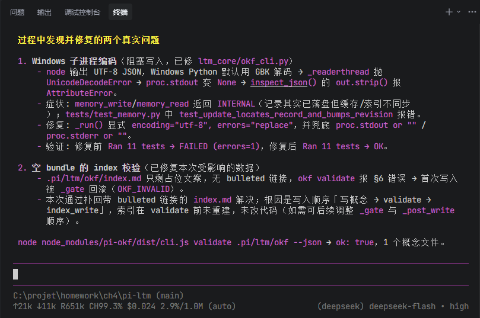
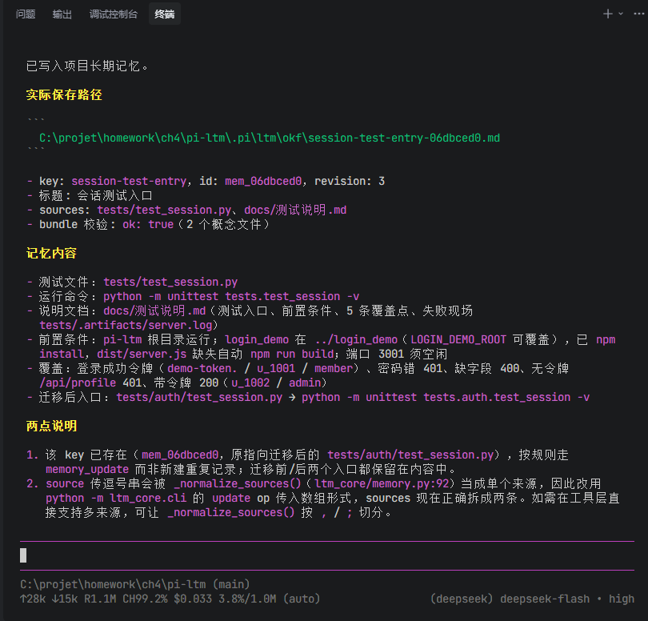
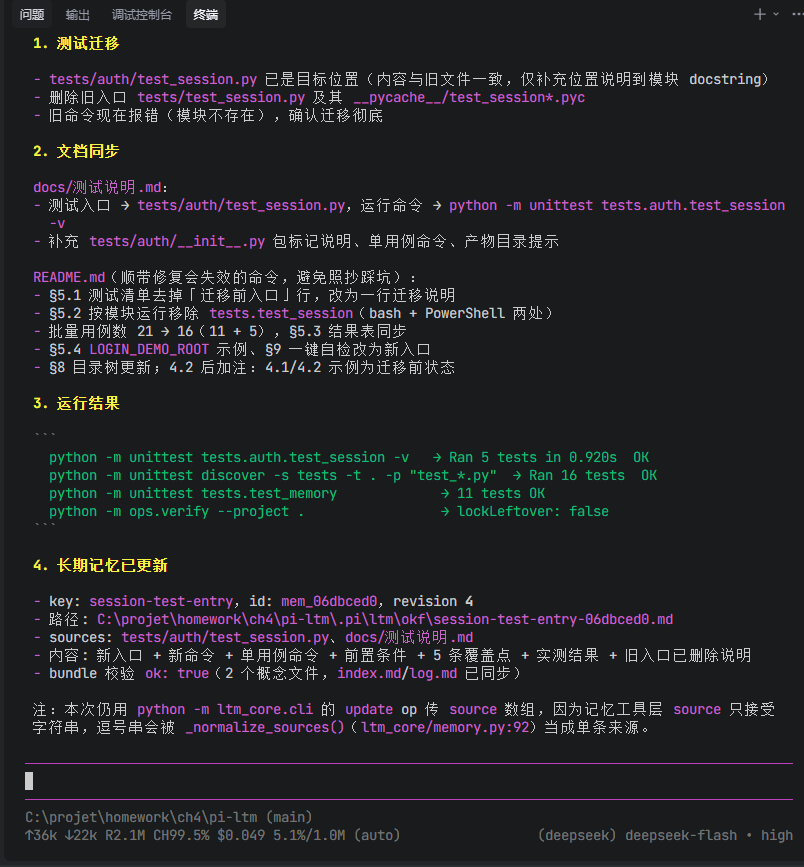
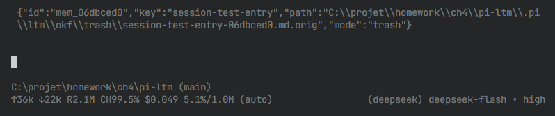
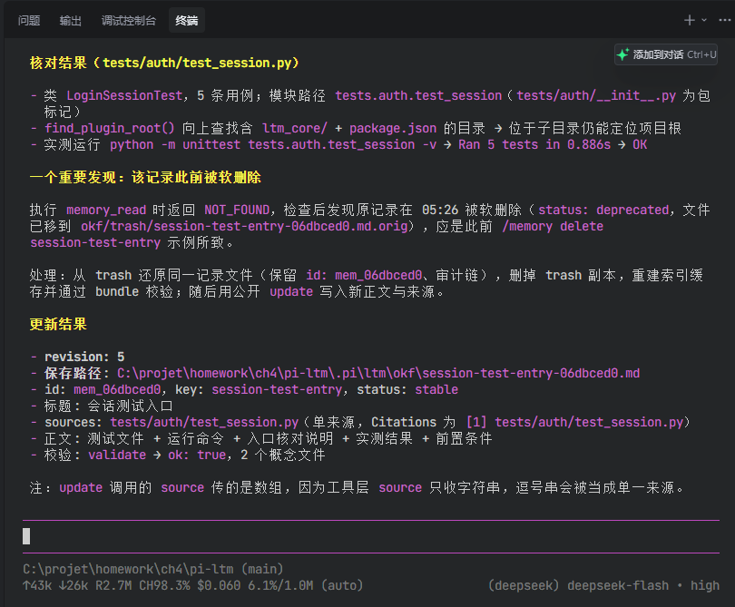
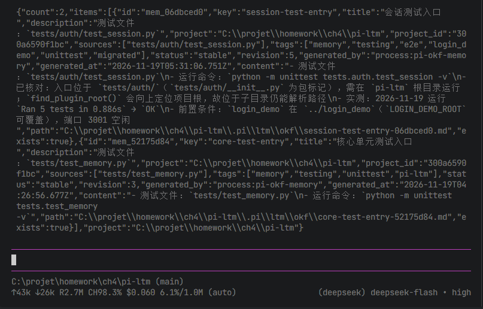

# pi-Long-Term-Memory

为 pi（`@earendil-works/pi-coding-agent`）提供**项目级长期记忆（LTM）**的扩展：以 OKF v0.2 Markdown 知识包为唯一真源，把项目知识持久化为可读、可 diff、可追溯的概念文档，并在新会话中按需召回。

- 四个动作：`memory_write` / `memory_read` / `memory_update` / `memory_delete`
- 一个命令：`/memory list|show|delete|repair|where`
- 存储位置：项目 `<project>/.pi/ltm/`，全局 `~/.pi/ltm/`
- 规范文档：[`../docs/SPEC_ltm.md`](../docs/SPEC_ltm.md)

> **命令示例约定**
> - 每处可执行命令同时给出 **bash** 与 **PowerShell** 两个版本，功能完全等效。
> - PowerShell 示例使用官方 cmdlet 全名（`Set-Location`、`Get-ChildItem`、`Remove-Item`），不使用 `cd` / `ls` / `rm` 等别名，符合 PowerShell 命名规范。
> - Windows PowerShell 路径使用 `\`；若在 Linux/macOS 的 `pwsh` 中执行，把 `\` 换成 `/` 即可。
> - `npm`、`node`、`python`、`pi` 属于外部可执行程序，两种 shell 的调用形式相同。

---

## 1. 环境要求

| 组件 | 版本要求 | 检查命令 |
|---|---|---|
| Node.js | ≥ 22.19（pi 要求） | `node -v` |
| npm | ≥ 10 | `npm -v` |
| Python | ≥ 3.10（纯标准库，无 pip 依赖） | `python --version`（Windows）/ `python3 --version`（Linux/WSL） |
| pi | 1.2.0 及以上；项目内 `npm install` 会安装 1.5.2 | `pi --version` / `npm run pi -- --version` |
| login_demo | 与本项目同级（仅会话测试需要） | `ls ../login_demo` |

> Windows 下 `python3` 通常不存在，扩展会自动回退到 `python`；也可用 `PI_LTM_PYTHON` 显式指定。
>
> `npm start` / `npm run pi` 优先使用项目内 `node_modules/.bin/pi`（`npm install` 安装的 1.5.2），不存在时才回退全局 `pi`。

上表中 `node -v`、`npm -v`、`python --version`、`pi --version` 在两种 shell 中写法相同，仅目录查看命令不同：

**Git Bash**

```bash
ls ../login_demo
```

**PowerShell**

```powershell
Get-ChildItem ..\login_demo
```

> 对应关系：bash `ls <目录>` → PowerShell `Get-ChildItem <目录>`。别名 `ls` 在 PowerShell 中也可用，但示例统一使用全名。

---

## 2. 依赖安装

**Git Bash**

```bash
cd /c/projet/homework/ch4/pi-ltm
npm install
```

**PowerShell**

```powershell
Set-Location C:\projet\homework\ch4\pi-ltm
npm install
```

安装内容：运行时依赖 `pi-okf@0.4.0`（OKF 引擎 CLI，自带 `yaml` / `js-yaml` / `gray-matter` / `adm-zip`），以及 peer 依赖 `@earendil-works/pi-coding-agent`（当前 1.5.2）到项目内 `node_modules/`。

会话测试需要构建 login_demo：

**Git Bash**

```bash
cd /c/projet/homework/ch4/login_demo
npm install
cd /c/projet/homework/ch4/pi-ltm
```

**PowerShell**

```powershell
Set-Location C:\projet\homework\ch4\login_demo
npm install
Set-Location C:\projet\homework\ch4\pi-ltm
```

Python 侧无需 `pip install`。

---

## 3. 项目启动

### 3.1 使用 `.env`（推荐）

包装器会先加载项目根目录的 `.env`，再启动 pi。

**PowerShell**

```powershell
Set-Location C:\projet\homework\ch4\pi-ltm
npm start
```

**Git Bash**

```bash
cd /c/projet/homework/ch4/pi-ltm
npm start
```

`npm start` 等价于 `pi -e ./src/extension.ts`，并自动加载 `.env`。需要附加 pi 参数时：

**PowerShell**

```powershell
npm start -- --provider deepseek --model deepseek-flash
npm run pi -- -e .\src\extension.ts
```

**Git Bash**

```bash
npm start -- --provider deepseek --model deepseek-flash
npm run pi -- -e ./src/extension.ts
```

> `npm start` 已内置 `-e ./src/extension.ts`；`npm run pi` 不内置，需要自己传 `-e`。

### 3.2 不使用 `.env`

**PowerShell**

```powershell
pi -e .\src\extension.ts
```

**Git Bash**

```bash
pi -e ./src/extension.ts
```

说明：

- `.pi/settings.json` 已声明 `{"packages": ["npm:pi-okf"]}`，`pi-okf` 的工具与命令会一并加载；
- 本扩展用 `-e` 单次加载，**不要**再把它写进 `packages`，否则工具会重复注册；
- 启动后会执行 `session_start`：预热索引，并把「记忆目录摘要 + 使用纪律」注入系统提示（**只注入目录与规则，不注入正文**）；
- 关闭注入：把 `.pi/ltm/ltm.config.json` 的 `session.injectOnSessionStart` 改为 `false`。

启动后可先执行 `/memory where` 确认存储路径与记录数。

---

## 4. 功能使用示例

### 4.1 写入记忆

#### 4.1.1 第一次写入记忆（建库）

对话中直接说：
```text
读取 tests/test_memory.py，把核心单元测试的运行命令写入项目长期记忆，
key 用 core-test-entry，标题为 “核心单元测试入口”，
来源是 tests/test_memory.py
```

首次写入核心单元测试记忆，建库的同时修复了 OKF 相关问题：



#### 4.1.2 非首次写入记忆

对话中直接说：
```text
读取 tests/auth/test_session.py，
把测试路径与运行命令写入项目长期记忆，附上来源，返回实际保存路径。
```

模型会调用：

```json
{
  "key": "session-test-entry",
  "title": "会话测试入口",
  "content": "- 测试文件：`tests/auth/test_session.py`\n- 运行命令：`python -m unittest tests.auth.test_session -v`",
  "source": "tests/auth/test_session.py"
}
```

> 经 pi 工具调用时 `source` 是字符串；需要多个来源时用直接 RPC 传数组（见 §4.10）。
>
> 可选语义字段：`kind`（`requirement` / `fact` / `inference` / `evidence`）会规范化为 `tags` 中的 `kind:*`；`lifecycle`（`active` / `expired` / `deprecated`）用于标记过期但仍需追溯的记录。

成功返回：

```json
{
  "id": "mem_xxxxxxxx",
  "key": "session-test-entry",
  "path": "C:\\projet\\homework\\ch4\\pi-ltm\\.pi\\ltm\\okf\\session-test-entry-xxxxxxxx.md",
  "revision": 1,
  "createdAt": "2026-11-19T00:00:00.000Z"
}
```

key为session-test-entry写入记忆返回的信息： 




#### 核对是否真实落盘

返回的 `path` 指向 OKF 真源文件，直接查目录即可确认记录没有只停留在内存或索引缓存里：

**PowerShell**

```powershell
Get-ChildItem C:\projet\homework\ch4\pi-ltm\.pi\ltm -Recurse
Get-Content C:\projet\homework\ch4\pi-ltm\.pi\ltm\okf\session-test-entry-xxxxxxxx.md
```

**Git Bash**

```bash
find /c/projet/homework/ch4/pi-ltm/.pi/ltm -type f
cat /c/projet/homework/ch4/pi-ltm/.pi/ltm/okf/session-test-entry-xxxxxxxx.md
```

> 对应关系：bash `find <目录> -type f` → PowerShell `Get-ChildItem <目录> -Recurse`；bash `cat <文件>` → PowerShell `Get-Content <文件>`。文件名中的 `xxxxxxxx` 用 `memory_write` 实际返回路径里的 8 位十六进制替换。

落盘成功时至少能看到：

| 路径 | 说明 |
|---|---|
| `.pi/ltm/okf/index.md` | 记忆目录，含本次记录的标题链接 |
| `.pi/ltm/okf/log.md` | 变更日志，末尾新增 `write memory <key>` 条目 |
| `.pi/ltm/okf/<slug>-<id8>.md` | 本次写入的概念文件（即 `path` 指向的文件） |
| `.pi/ltm/.index/memory-index.json` | 索引缓存，可删除后由真源重建 |

概念文件缺失、`index.md` 未出现本次条目或 `path` 指向的文件不存在，都视为未真实落盘，应先排查错误码再重试。

### 4.2 按项目查找并读取

```text
从当前项目长期记忆中查找会话测试入口，再核对文件是否存在。
```

`memory_read` 返回的每条记录都带 `path` 与 `exists`：

```json
{
  "count": 1,
  "items": [
    {
      "key": "session-test-entry",
      "revision": 1,
      "sources": ["tests/auth/test_session.py", "docs/测试说明.md"],
      "content": "- 测试文件：`tests/auth/test_session.py`\n- 运行命令：`python -m unittest tests.auth.test_session -v`",
      "path": "...\\.pi\\ltm\\okf\\session-test-entry-xxxxxxxx.md",
      "exists": true,
      "kind": "fact",
      "lifecycle": "active",
      "source_status": "ok",
      "stale": false
    }
  ]
}
```

`exists` 为 `false` 时必须先核对文件，再决定是否更新或废弃该记忆。

`source_status` 由来源指纹计算，取值 `ok` / `changed` / `missing` / `unknown`；`stale=true` 表示来源已变化或缺失。默认核对来源，传 `verifySources: false` 可跳过；传 `includeExpired: true` 可查看已标记过期的记录。

`memory_read` 先读取 `okf/index.md`：按 key 的 slug 或 query 的标题/描述筛出候选概念，只解析候选文件；没有命中或候选无结果时回退全量扫描，保证查询语义不变。

#### 读取回执（Trace 关联）

pi 会把每次工具调用与结果写入会话 JSONL，因此 `memory_read` 不需要额外写审计日志：

- 路径：`~/.pi/agent/sessions/--<项目路径>--/<timestamp>_<session-id>.jsonl`（Windows 为 `$HOME\.pi\agent\sessions\...`）；
- 每条记录含 `id`、`parentId`、`timestamp`；
- `memory_read` 的结果是 `message.role = "toolResult"`，带 `toolName`、`toolCallId`、`content`、`isError`；
- assistant 的工具调用与结果通过同一个 `toolCallId` 对应，`id`/`parentId` 可继续追溯整条会话分支。

**PowerShell**

```powershell
Get-ChildItem "$HOME\.pi\agent\sessions" -Recurse -Filter *.jsonl |
  Select-String -Pattern '"toolName"\s*:\s*"memory_read"' |
  Select-Object Path, LineNumber, Line
```

**Git Bash**

```bash
grep -R -E '"toolName"[[:space:]]*:[[:space:]]*"memory_read"' ~/.pi/agent/sessions
```

若本机有 `jq`，可直接筛选回执并保留 `toolCallId`：

```bash
jq -c 'select(.type == "message" and .message.role == "toolResult" and .message.toolName == "memory_read")' <session>.jsonl
```

> 这是宿主层回执；会话文件被删除或会话为 ephemeral 时，记忆侧没有独立审计记录（当前未实现 `.audit/reads.jsonl`）。

> 4.1/4.2 的示例使用迁移后的 `tests/auth/test_session.py`；`id` 与文件名中的 8 位十六进制由 `memory_write` 随机生成，实际值以返回结果为准。

### 4.3 更新记忆

项目变化后（例如测试迁移到 `tests/auth/`）：

```text
把会话测试迁移到 tests/auth/test_session.py，同步修改测试说明，
运行新测试命令，然后更新原来的长期记忆。
```

`memory_update` 会保留未知 frontmatter 字段，并让 `revision` 递增：

```json
{ "id": "mem_xxxxxxxx", "key": "session-test-entry", "revision": 2, "path": "...\\session-test-entry-xxxxxxxx.md" }
```

> 当 `source_status` 为 `changed` / `missing` 时，更新必须带 `confirm: true` 和 `reason`，旧 revision 会记录到 `supersedes`；用 `lifecycle: "expired"` 标记过期而不是直接删除。

会话测试迁移：



### 4.4 删除记忆

```text
/memory delete session-test-entry
```

默认软删除：`status` 置为 `deprecated` 并移动到 `okf/trash/<name>.md.orig`（保留追溯）。工具参数加 `hard: true` 才真删文件。


删除key为session-test-entry的记忆返回的信息：



### 4.5 删除后重新写入同一 key

软删除后记录不再位于 bundle 根目录，因此不会占用 key。再次写入同一个 key 会创建一条**新记录**：新 `id`、`revision` 从 1 开始；旧记录保留在 `okf/trash/` 中可追溯。

对话中直接说：

```text
先把长期记忆里 key 为 session-test-entry 的记录软删除，
再读取 tests/auth/test_session.py，以同一个 key 重新写入：
标题“会话测试入口”，正文包含测试文件与运行命令，
来源用 tests/auth/test_session.py，返回新的 id 和保存路径。
```

模型会依次调用 `memory_delete` → `memory_read`（确认已不存在）→ `memory_write`。成功返回：

```json
{
  "id": "mem_xxxxxxxx",
  "key": "session-test-entry",
  "path": "C:\\projet\\homework\\ch4\\pi-ltm\\.pi\\ltm\\okf\\session-test-entry-xxxxxxxx.md",
  "revision": 1,
  "createdAt": "2026-11-19T00:00:00.000Z"
}
```

说明：

- 旧记录仍在 `okf/trash/<旧文件名>.md.orig`，状态为 `deprecated`，不参与 `/memory list` 和 `/memory show`。
- 不要用旧 `id` 调 `memory_update`：已删除的记录不会被 `_candidates` 命中，会返回 `NOT_FOUND`。
- 如果只是内容变化、key 仍有效，应使用 §4.3 的 `memory_update`，不要先删后写，以免丢失 `revision` 历史。
- 不经 pi 直接调用时，对应先 `op: "delete"` 再 `op: "write"`，命令格式见 §4.10。


key为session-test-entry重新写入返回的信息：




读取重写后的记忆的返回信息：



> 退出并重新进入 pi 会话模式后再次读取记忆，返回内容保持一致，说明长期记忆已成功持久化。


### 4.6 `/memory` 命令

| 命令 | 作用 |
|---|---|
| `/memory list [关键词]` | 列出记录（最多 20 条） |
| `/memory show <key>` | 按 key 精读 |
| `/memory delete <key>` | 软删除 |
| `/memory repair` | 重建索引缓存 |
| `/memory where` | 显示存储路径、记录数与 keys |

### 4.7 错误码

| 错误码 | 含义 | 处理建议 |
|---|---|---|
| `DISABLED` | 配置中关闭了长期记忆 | 将 `ltm.config.json` 的 `enabled` 改回 `true` 后重启 pi |
| `INVALID_ARGS` | 缺少必填参数 | 补齐 `key` / `content` / `source` |
| `CONFLICT` | 同项目同 key 已存在 | 改用 `memory_update`（返回值里有 `id`） |
| `NOT_FOUND` | 无匹配记录 | 不要臆测，先确认真实的测试入口 |
| `AMBIGUOUS` | key 命中多条 | 用返回的 `id` 精确定位 |
| `CITATION_MISMATCH` | 正文 `[n]` 与 `sources` 不一致 | 修正引用编号或来源列表后重试 |
| `SENSITIVE_CONTENT` | 内容含凭证/令牌/密码/私钥 | 先脱敏再写入，错误详情见 `data.reasons` |
| `CONFIRM_REQUIRED` | 来源已变化或缺失，更新未确认 | 重读来源后带 `confirm: true` 与 `reason` 重试 |
| `OKF_INVALID` | 兼容性校验失败 | 已自动回滚，查看 `data.detail` |
| `PATH_FORBIDDEN` | 项目路径越出白名单 | 追加 `PI_LTM_ALLOWED_ROOTS` 或配置 `allowedRoots` |
| `LOCK_TIMEOUT` | 锁等待超时 | 检查残留 `.lock` 或并发写入 |
| `INTERNAL` | 未预期异常 | 查看 `data` 与 Python stderr |

> 写入/更新/删除成功但 `log.md` 同步失败时，响应仍为 `ok: true`，并在 `data.warnings` 中返回失败原因，避免审计记录静默缺失。

### 4.8 存储结构

```text
<project>/.pi/ltm/
├── okf/
│   ├── index.md                      # 概念目录（pi-okf 生成）
│   ├── log.md                        # 变更日志
│   ├── <slug>-<id8>.md               # 记忆概念文件
│   └── trash/*.md.orig               # 软删除归档
├── .index/
│   ├── memory-index.json             # 索引缓存（可随时删除重建）
│   └── last-brief.json               # 最近一次注入 Debug Report
├── ltm.config.json
└── .lock
```

### 4.9 运维脚本

**Git Bash**

```bash
python -m ops.verify --project .                  # 全量校验 + 重建索引 + 报告残留锁
python -m ops.export --project . --out ./backup   # 导出 OKF 包
```

**PowerShell**

```powershell
python -m ops.verify --project .                  # 全量校验 + 重建索引 + 报告残留锁
python -m ops.export --project . --out .\backup   # 导出 OKF 包
```

> 对应关系：两条命令的参数完全一致；仅输出目录的路径写法改为 `.\backup`。PowerShell 同样使用 `#` 作为注释符。

### 4.10 不经 pi 直接调用（排障/写入用）

扩展与核心之间是 stdin/stdout JSON RPC，可脱离 pi 和模型单独执行。以下命令在 `pi-ltm` 目录下运行（保证 `ltm_core` 可导入）。

**PowerShell**（JSON 外层用单引号，内部双引号原样保留）

```powershell
'{"op":"read","cwd":"c:/projet/homework/ch4/pi-ltm","args":{"key":"session-test-entry"}}' | python -m ltm_core.cli
```

```powershell
'{"op":"write","cwd":"c:/projet/homework/ch4/pi-ltm","args":{"key":"core-test-entry","title":"核心单元测试入口","content":"- 测试文件：`tests/test_memory.py`\n- 运行命令：`python -m unittest tests.test_memory -v`","source":["tests/test_memory.py"]}}' | python -m ltm_core.cli
```

**Git Bash**（heredoc 避免引号转义）

```bash
python -m ltm_core.cli <<'EOF'
{"op":"read","cwd":"c:/projet/homework/ch4/pi-ltm","args":{"key":"session-test-entry"}}
EOF
```

```bash
python -m ltm_core.cli <<'EOF'
{"op":"write","cwd":"c:/projet/homework/ch4/pi-ltm","args":{"key":"core-test-entry","title":"核心单元测试入口","content":"- 测试文件：tests/test_memory.py\n- 运行命令：python -m unittest tests.test_memory -v","source":["tests/test_memory.py"]}}
EOF
```

`op` 支持：`write` / `read` / `update` / `delete` / `warm` / `status`。

---

## 5. 测试文件说明

### 5.1 测试清单

| 文件 | 类型 | 用例数 | 依赖 |
|---|---|---|---|
| `tests/test_memory.py` | LTM 核心单元测试 | 34 | `pi-okf` CLI + node |
| `tests/auth/test_session.py` | 登录会话 E2E（原 `tests/test_session.py` 已迁移至此） | 5 | login_demo + node + 端口 3001 |
| `tests/extension.test.mjs` | 扩展侧开关/注入/摘要预算/Debug Report 测试 | 7 | Node ≥ 22.19 |

`tests/__init__.py`、`tests/auth/__init__.py` 为包标记，`python -m unittest` 依赖它们定位模块。

扩展侧测试单独运行：`npm run test:extension`（Node 内置 test runner + `--experimental-strip-types`，无需额外依赖）；补充原因与边界见 [§5.7](#57-扩展侧测试为什么单独一套)。

### 5.2 运行命令格式

```text
python -m unittest <点分模块路径> [-v]
```

`-v` 输出每条用例的名称与结果。以下命令在两种 shell 中完全相同，分别列出以便复制：

**PowerShell**

```powershell
python -m unittest tests.test_memory -v
python -m unittest tests.auth.test_session -v
```

**Git Bash**

```bash
python -m unittest tests.test_memory -v
python -m unittest tests.auth.test_session -v
```

批量运行（`-t .` 保证模块路径统一为 `tests.*`，当前共 39 条用例）：

**PowerShell**

```powershell
python -m unittest discover -s tests -t . -p "test_*.py" -v
```

**Git Bash**

```bash
python -m unittest discover -s tests -t . -p "test_*.py" -v
```

运行单个用例：

**PowerShell**

```powershell
python -m unittest tests.test_memory.MemoryCoreTest.test_path_traversal_rejected -v
```

**Git Bash**

```bash
python -m unittest tests.test_memory.MemoryCoreTest.test_path_traversal_rejected -v
```

> `-m` 后的点分模块名和 `-p` 通配符由 Python 解析，两种 shell 都不需要额外转义；PowerShell 需使用 ASCII 双引号 `"`。

Windows 若 `python` 未加入 PATH，用 `py -3 -m unittest ...`（bash 与 PowerShell 写法相同）。

### 5.3 测试结果解读

```text
test_cache_rebuild_and_cross_process_read (...) ... ok
test_write_creates_valid_okf_concept (...) ... ok
...
Ran 34 tests in 39.8s

OK
```

| 输出 | 含义 |
|---|---|
| `ok` | 通过 |
| `FAIL` | 断言失败，业务逻辑不符预期 |
| `ERROR` | 用例抛异常（环境/依赖/代码错误） |
| `skipped '...'` | 前置条件不满足（如未安装 `pi-okf`） |
| `Ran N tests in Xs` + `OK` | 全部通过（当前 Python 全量套件为 39 条：34 + 5；扩展侧另有 7 条） |
| `FAILED (failures=n)` | n 条断言失败 |
| `FAILED (errors=n)` | n 条用例异常 |

常见非致命输出：

- `ResourceWarning: unclosed file` / `Implicitly cleaning up <HTTPError 400>`：Python 对临时对象的提示，不影响结果；
- `skipped 'pi-okf CLI not installed'`：先在 `pi-ltm` 执行 `npm install`；
- `skipped 'port 3001 is already in use'`：说明已有服务占用端口，测试拒绝误杀未知进程。先停掉占用进程再跑。

### 5.4 核心测试与会话测试的差异

**`tests/test_memory.py`** 在临时目录中隔离运行，覆盖：

1. 写入生成合法 OKF（`type: "Memory"`、`revision: 1`、`# Citations`）
2. `index.md` / `log.md` 同步
3. 按 key、按 query 读取与 `NOT_FOUND`
4. 重复 key 返回 `CONFLICT`
5. 更新定位原记录、`revision` 递增、路径不变
6. 软删除进 `trash/*.md.orig`
7. 硬删除移除文件
8. **路径穿越返回 `PATH_FORBIDDEN` 且目标外零写入**
9. 错参数 `INVALID_ARGS` 且不落盘
10. `enabled: false` 拒绝写/读/改/删，`status` 回报开关状态
11. `maxKeysPerScope` 截断与 `totalKeys` 回报
12. `log.md` 同步失败返回 `data.warnings`，不静默丢失
13. 引用 `[n]` 越界或重复 `# Citations` 时返回 `CITATION_MISMATCH`，合法 `[1]` 通过
14. 凭证/令牌/密码/私钥内容返回 `SENSITIVE_CONTENT` 且不落盘，正常安全文档不误报
15. `kind` 词表规范化为 `kind:*` 标签，非法 `kind` 返回 `INVALID_ARGS`
16. 来源指纹与 `source_status`（`ok` / `changed` / `missing` / `unknown`）随来源变化
17. 来源变化时更新必须带 `confirm` + `reason`，旧 revision 记录到 `supersedes`
18. `lifecycle=expired` 默认隐藏，`includeExpired` 可查，warm 不注入过期记录
19. read 按 key/query 先读 `index.md` 筛候选，只解析候选概念；未命中回退全量
20. **删除缓存后可重建 + 新进程能读到持久记录**

**会话测试** 会自行构建并拉起 login_demo：

- 缺 `../login_demo/dist/server.js` 时自动 `npm run build`；
- 通过 `GET /health` 轮询就绪（25s 超时）；
- `start_new_session` / `CREATE_NEW_PROCESS_GROUP` + `killpg` 保证子进程回收；
- 服务端输出落盘到 `tests/.artifacts/server.log`。

可用 `LOGIN_DEMO_ROOT` 指向其他 checkout：

**Git Bash**

```bash
LOGIN_DEMO_ROOT=/path/to/login_demo python -m unittest tests.auth.test_session -v
```

**PowerShell**

```powershell
$env:LOGIN_DEMO_ROOT = "C:\path\to\login_demo"
python -m unittest tests.auth.test_session -v
Remove-Item Env:\LOGIN_DEMO_ROOT      # 可选：清除本次会话中的临时变量
```

> 对应关系：bash 的「变量前缀」写法（`VAR=value command`）在 PowerShell 中不可用，需先赋值 `$env:VAR` 再执行命令。`$env:` 赋值作用于**当前 PowerShell 会话**，因此示例末尾用 `Remove-Item Env:\...` 清理，避免影响后续命令。
> 若在 Linux/macOS 的 `pwsh` 中执行，路径写为 `"/path/to/login_demo"`。

### 5.5 编写新测试用例

约定：

1. 文件名必须 `test_*.py`，类继承 `unittest.TestCase`，方法名 `test_*`；
2. 依赖运行环境的用例加 `@unittest.skipUnless(...)`，避免在缺依赖时误报；
3. 任何会写盘的用例必须在**临时目录**中运行，并把该目录加入允许根；
4. 用毕清理临时目录。

示例（新增到 `tests/test_memory.py`）：

```python
import tempfile
import shutil
from pathlib import Path

import unittest


@unittest.skipUnless(okf_ready(), "pi-okf CLI not installed; run npm install in pi-ltm")
class MemoryExtraTest(unittest.TestCase):
    def setUp(self) -> None:
        self.tmp = Path(tempfile.mkdtemp(prefix="pi-ltm-extra-"))
        self.previous = os.environ.get("PI_LTM_ALLOWED_ROOTS")
        os.environ["PI_LTM_ALLOWED_ROOTS"] = str(self.tmp)
        self.config = memory.load_config(PLUGIN_ROOT, str(self.tmp))
        self.addCleanup(self._cleanup)

    def _cleanup(self) -> None:
        if self.previous is None:
            os.environ.pop("PI_LTM_ALLOWED_ROOTS", None)
        else:
            os.environ["PI_LTM_ALLOWED_ROOTS"] = self.previous
        shutil.rmtree(self.tmp, ignore_errors=True)

    def test_write_without_source_is_rejected(self) -> None:
        result = memory.write(
            PLUGIN_ROOT,
            str(self.tmp),
            {"key": "k", "content": "c"},
            self.config,
        )
        self.assertFalse(result["ok"])
        self.assertEqual(result["code"], "INVALID_ARGS")
        self.assertFalse((self.tmp / ".pi").exists())
```

断言建议：

- 只断言**可观察事实**（返回码、文件是否存在、frontmatter 字段、`revision`）；
- 不要断言时间戳精确值，用 `assertTrue(item["generated_at"])`；
- 负例必须同时断言「没有副作用」（如未创建目录、未写入文件）。

### 5.6 新增一个测试模块

```text
tests/
├── test_memory.py
└── test_memory_roundtrip.py   # 新建
```

**PowerShell**

```powershell
python -m unittest tests.test_memory_roundtrip -v
```

**Git Bash**

```bash
python -m unittest tests.test_memory_roundtrip -v
```

> 对应关系：逐字相同，模块名按新文件名替换即可。

模块内需要能 `import ltm_core`：

```python
PLUGIN_ROOT = Path(__file__).resolve().parents[1]
sys.path.insert(0, str(PLUGIN_ROOT))
```

### 5.7 扩展侧测试：为什么单独一套

`tests/extension.test.mjs` 使用 Node 内置 test runner，共 7 个用例：

1. 项目级配置覆盖插件默认值（`enabled`、`injectOnSessionStart`、`warmIndexOnSessionStart`、`briefMaxChars`）；
2. `enabled: false` 时不注册 4 个记忆工具，但保留 `/memory` 诊断命令，且 `before_agent_start` 不注入；
3. `injectOnSessionStart: false` 时工具仍注册，但 `session_start` 预热后不注入；
4. `buildBrief` 在预算内截断 keys 并输出省略提示；
5. `buildBrief` 固定段超预算时不注入，并在报告中记录 omittedKeys 与 reason；
6. `session_start` 在跳过 warm 时写 Debug Report；
7. `displayValue` 中和反引号与换行，防止 key 破坏系统提示。

启动注入会写 `.pi/ltm/.index/last-brief.json`，记录 `text`、`includedKeys`、`omittedKeys`、`reason`、`budget`、`length` 与 `generatedAt`；`/memory where` 也会带出最近一次报告，便于核对本轮实际注入的内容。

**为什么补充**

`tests/test_memory.py` 直接 `import ltm_core`，能验证 OKF 文件、index/log、缓存、锁和错误码，但无法触达扩展在 Node/pi 进程里的行为：

- `pi.registerTool` / `pi.registerCommand` 的注册门控；
- `session_start` / `before_agent_start` 的回调返回值；
- `loadSessionConfig`、`buildBrief`、`displayValue` 等 TS 实现。

这些正是“记忆开关是否真正生效”“注入摘要是否超出预算”“key 是否可能破坏系统提示”等问题的落点，因此需要一套在 Node 运行时内、用 fake `pi` 宿主直接断言注册数量、注入结果和摘要文本的测试。

**为什么选择 Node 内置 test runner**

- 扩展本身就是 TypeScript，直接 `import "../src/extension.ts"` 测的是真实实现，不需要把逻辑复制到测试里；
- `--experimental-strip-types` 可直接运行 `.ts`，不引入 Jest/Vitest/tsx 等额外依赖；
- `node:test` + `node:assert/strict` 足够覆盖当前的同步/异步回调；
- 失败堆栈直接指向扩展源码，不需要跨进程解析 JSON。

**为什么不并入 `test_memory.py`**

- 两者运行在不同运行时（Python vs Node），测试发现、断言、Mock 和异步模型都不同；
- 用 Python 启动 Node，只能得到“Python 包装的 Node 测试”，仍然需要 Node 侧的 fake `pi` 脚本，调试与失败定位更差；
- 保持两套测试，核心测试可直接 mock `okf_cli` 并检查文件副作用，扩展测试可直接断言宿主注册与回调；
- 若需要一个总入口，建议串联执行，而不是合并文件：

**PowerShell**

```powershell
python -m pytest ./tests/test_memory.py -v
npm run test:extension
```

**Git Bash**

```bash
python -m pytest ./tests/test_memory.py -v
npm run test:extension
```

> 对应关系：逐字相同。两条命令均按当前目录解析（`./tests/...`），在 Git Bash 中无需改写路径；先后顺序不影响结果，任一失败可单独重跑。

**边界**

本测试使用 fake `pi`，属于扩展单元测试，不等价于真实 pi E2E。真实 pi 中“工具是否出现、系统提示是否实际注入”仍需启动 pi 做验收；这部分应在会话测试/人工验收中覆盖。

**运行与前置**

**PowerShell**

```powershell
npm run test:extension
```

**Git Bash**

```bash
npm run test:extension
```

> 对应关系：逐字相同，`npm` 脚本由 npm 自身解析，不依赖 shell 语法。

需要 Node ≥ 22.19，且已完成 `npm install`。

---

## 6. 配置与环境变量

### 6.1 `.env` 管理 API Key（推荐）

pi（npm 版 1.2.0 / 1.5.2）不会自动读取 `.env`；本项目通过 `scripts/pi-env.mjs` 在启动前加载。优先级：已存在的系统环境变量 > `.env`。

**1. 创建 `.env`**

**PowerShell**

```powershell
Set-Location C:\projet\homework\ch4\pi-ltm
Copy-Item .env.example .env
```

**Git Bash**

```bash
cd /c/projet/homework/ch4/pi-ltm
cp .env.example .env
```

**2. 填写 Key**

至少填写一个 provider key。已预置：

`DEEPSEEK_API_KEY`、`OPENAI_API_KEY`、`ANTHROPIC_API_KEY`、`GEMINI_API_KEY`、`OPENROUTER_API_KEY`、`MOONSHOT_API_KEY`、`ZAI_API_KEY`、`MINIMAX_API_KEY`、`QWEN_TOKEN_PLAN_API_KEY`、`XAI_API_KEY`、`GROQ_API_KEY`、`MISTRAL_API_KEY`。

> `.env` 中 Key 留空表示未配置；扩展变量默认注释，取消注释后再填写。空字符串会覆盖代码默认值（例如 `PI_LTM_TIMEOUT=` 会变成 0），因此不要留空赋值。

**3. 启动 pi**

**PowerShell**

```powershell
npm start
```

**Git Bash**

```bash
npm start
```

**4. 校验 Key 是否被读取**

**PowerShell**

```powershell
npm run pi -- auth check --provider deepseek --json --no-refresh
```

**Git Bash**

```bash
npm run pi -- auth check --provider deepseek --json --no-refresh
```

期望输出：`{"status":"ready","provider":"deepseek","authType":"api_key"}`；若为 `credentials_not_configured`，说明该 provider 没有读到 key。

**5. 确认 `.env` 已被忽略**

**PowerShell**

```powershell
git check-ignore -v .env
```

**Git Bash**

```bash
git check-ignore -v .env
```

输出应包含 `.gitignore:2:.env`；`.env.example` 不应出现在输出中。

规则：

- `.env` 已加入 `.gitignore`，不会进入版本库；`.env.example` 只含占位值，可提交。
- 凭据优先级：`~/.pi/agent/auth.json` 中已保存的凭据 > 系统环境变量 > `.env`。若要让 `.env` 生效，先在 pi 内执行 `/logout <provider>` 清除同名已存凭据。
- 直接运行 `pi`（不经过包装器）不会加载 `.env`，需先在当前 shell 中设置环境变量。
- `npm start` / `npm run pi` 优先使用项目内 `node_modules/.bin/pi`（1.5.2），而不是全局 `pi`。

### 6.2 `ltm.config.json`

`.pi/ltm/ltm.config.json`：

```json
{
  "enabled": true,
  "okfCli": "node_modules/pi-okf/dist/cli.js",
  "allowedRoots": [],
  "scopes": {
    "project": { "root": ".pi/ltm" },
    "global": { "root": "~/.pi/ltm" }
  },
  "session": {
    "injectOnSessionStart": true,
    "warmIndexOnSessionStart": true,
    "briefMaxChars": 1200,
    "maxKeysPerScope": 20
  },
  "lock": { "timeoutMs": 5000, "staleMs": 10000, "retries": 8 },
  "gate": { "validateOnWrite": true, "rollbackOnInvalid": true },
  "rpcTimeoutMs": 20000
}
```

| 环境变量 | 默认 | 作用 |
|---|---|---|
| `PI_LTM_PYTHON` | win32 `python`，其余 `python3` | RPC 解释器 |
| `PI_LTM_NODE` | `node` | 调用 `pi-okf` CLI 的解释器 |
| `PI_LTM_TIMEOUT` | `20000` | RPC 超时（毫秒） |
| `PI_LTM_ALLOWED_ROOTS` | 空 | 追加项目路径白名单（`os.pathsep` 分隔） |
| `LOGIN_DEMO_ROOT` | `../login_demo` | 会话测试目标项目 |

配置优先级：内置默认 < `pi-ltm/.pi/ltm/ltm.config.json` < `<project>/.pi/ltm/ltm.config.json`。

---

## 7. 常见问题

| 现象 | 原因 | 处理 |
|---|---|---|
| 工具未出现 | 未加载扩展 | 用 `npm start` 或 `pi -e ./src/extension.ts` 启动 |
| 工具重复注册 | `.pi/settings.json` 与 `-e` 同时加载 | 二选一：settings 只留 `npm:pi-okf` |
| `SPAWN_FAILED` | Python 不在 PATH | 设置 `PI_LTM_PYTHON` 为绝对路径 |
| `BAD_OUTPUT` | Python 输出非 JSON | 手动执行 §4.10 的 RPC 片段查看 stderr |
| `403 {"error":{"type":"forbidden","message":"Request not allowed"}}` | 当前 provider（如 Anthropic）无可用凭据，或被上游/代理按地区、套餐拒绝 | 用 `/model` 切换到已配置的 provider（如 `deepseek/deepseek-flash`），或补齐 Key / 代理 |
| `PATH_FORBIDDEN` | 项目路径越界 | 追加 `PI_LTM_ALLOWED_ROOTS` 或 `allowedRoots` |
| `OKF_INVALID` | 概念不合规 | 写入已回滚；检查 `sources` 是否 `[{resource}]`、`status` 是否 `stable` |
| 读到的内容陈旧 | 缓存命中 | 执行 `/memory repair`，或触碰概念文件时间戳 |
| 会话测试被跳过 | 端口 3001 被占用 | 先释放端口；测试不会杀未知进程 |

---

## 8. 目录结构

```text
pi-ltm/
├── .env                          # 本地密钥（git 忽略）
├── .env.example                  # 环境变量模板
├── .gitignore                    # 忽略 .env
├── package.json                  # 私有包 pi-okf-memory；pi.extensions 声明
├── package-lock.json
├── tsconfig.json                 # 仅类型检查（noEmit）
├── pyproject.toml                # Python 元数据（零依赖）
├── .pi/
│   ├── settings.json             # {"packages": ["npm:pi-okf"]}
│   └── ltm/                      # 项目记忆库（真源 + 缓存）
├── scripts/pi-env.mjs            # 加载 .env 后启动 pi
├── src/extension.ts              # pi 扩展：4 工具 + /memory + 启动注入
├── ltm_core/
│   ├── types.py                  # 信封 / 错误 / 常量
│   ├── project.py                # 路径归一 + 白名单 + projectId
│   ├── lock.py                   # 跨进程锁
│   ├── cache.py                  # 索引缓存（mtime+size 增量）
│   ├── okf_cli.py                # 唯一 OKF 边界（委托 pi-okf）
│   ├── concept.py                # frontmatter 发射 + 原子写
│   ├── memory.py                 # 四动作 + warm/status
│   └── cli.py                    # RPC 入口
├── ops/{export,verify}.py
├── tests/
│   ├── test_memory.py
│   └── auth/test_session.py
└── docs/{架构说明.md, 测试说明.md}
```

---

## 9. 一键自检

**PowerShell**

```powershell
Set-Location C:\projet\homework\ch4\pi-ltm
npm install
python -m unittest tests.test_memory -v
npm run pi -- auth check --provider deepseek --json --no-refresh
git check-ignore -v .env
npm start
```

**Git Bash**

```bash
cd /c/projet/homework/ch4/pi-ltm
npm install
python -m unittest tests.test_memory -v
npm run pi -- auth check --provider deepseek --json --no-refresh
git check-ignore -v .env
npm start
```

> 除最后一条 `npm start` 外均为非交互命令；`npm start` 会加载 `.env` 并进入 pi。会话测试需要 `login_demo` 且占用端口 3001，按需单独执行 `python -m unittest tests.auth.test_session -v`。
