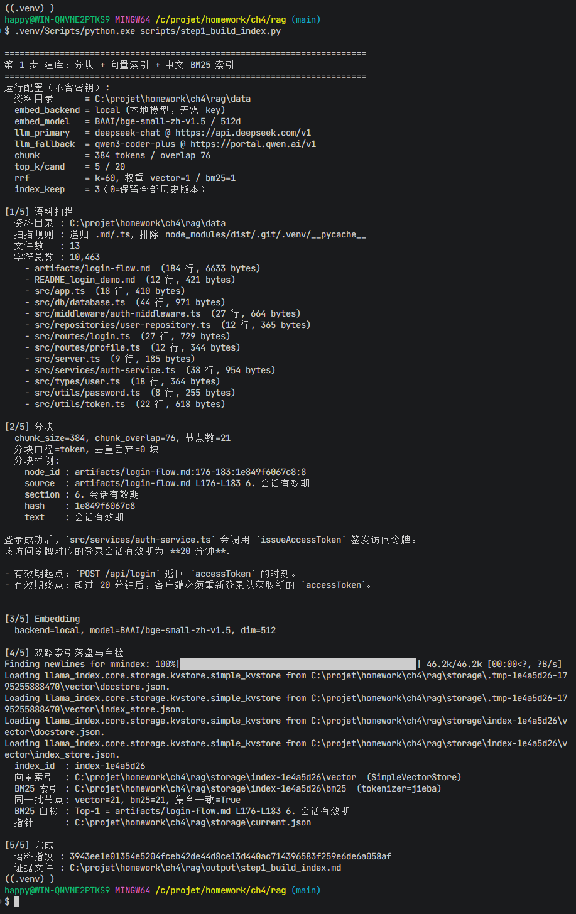
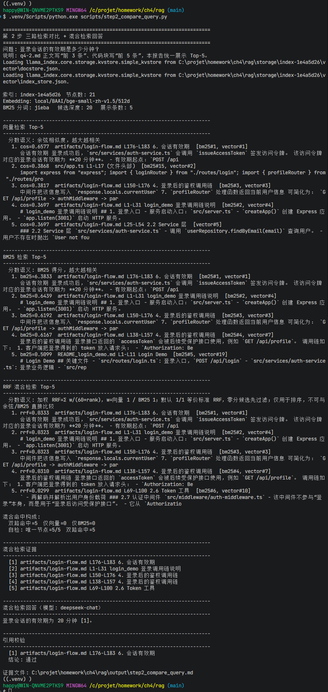
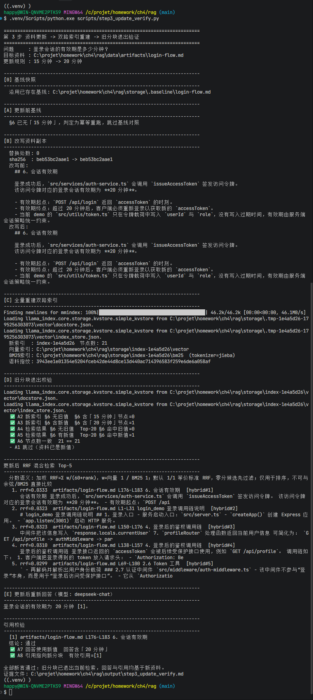

# LlamaIndex 的向量 + 关键词混合检索 RAG

本工程对应 `docs/rag/q4-2.md` 的三步作业要求，详细设计见 [`../docs/rag/SPEC_rag.md`](../docs/rag/SPEC_rag.md)。

| 步骤 | 做什么 | 产物 |
|---|---|---|
| step1 | 读取资料 → 分块 → 向量索引 + 中文 BM25 索引 → 双路落盘 | `output/step1_build_index.md` |
| step2 | 向量 / BM25 / RRF 三路对比 + 混合证据问答（带 `[n]` 引用） | `output/step2_compare_query.md` |
| step3 | 有效期 15 → 20 分钟 → 重建双路索引 → 断言旧分块退出；`--restore` 可回到 15 分钟 | `output/step3_update_verify.md` / `output/step3_restore.md` |

---

## 1. 目录结构

```
rag/
├── .env                      # 本地密钥（已被 .gitignore 忽略，需自己创建）
├── .env.example              # 环境变量模板
├── .gitignore
├── README.md                 # 本文档
├── pytest.ini                # pytest 配置（tests/ + test_*.py）
├── requirements.txt          # 核心依赖（纯 wheel）
├── requirements-local-embed.txt  # 本地 Embedding：torch + sentence-transformers
├── data/                     # 资料副本（唯一检索语料）
│   ├── artifacts/login-flow.md
│   ├── README_login_demo.md
│   └── src/**/*.ts
├── storage/                  # 索引产物与 step3 基线（索引可重建；.baseline 不受 git 管理）
│   ├── .baseline/login-flow.md  # step3 的 15 分钟基线快照（--restore 使用；删除 storage/ 会一并丢失）
│   ├── current.json
│   └── index-<hash8>/
│       ├── vector/
│       ├── bm25/
│       └── manifest.json
├── output/                   # 三步运行的 .md 证据
├── rag_core/                 # 核心模块
│   ├── __init__.py
│   ├── config.py             # 配置、路径、错误码
│   ├── providers.py          # Embedding / LLM 构造、重试与主备切换
│   ├── corpus.py             # 语料扫描、分块、行号/章节、块级去重
│   ├── indexer.py            # 双路建库、版本化提交、加载校验、版本保留
│   ├── retrieval.py          # 向量 / 中文 BM25 / 加权 RRF
│   ├── answering.py          # 引用约束提示词、回答渲染与解析
│   └── formatting.py         # stdout 与文件同源输出（stderr 仅诊断；写报告失败时降级为仅屏幕）
├── scripts/                  # 入口脚本
│   ├── check_env.py          # 环境自检（按后端检查依赖 + 配置）
│   ├── step1_build_index.py
│   ├── step2_compare_query.py
│   └── step3_update_verify.py
└── tests/                    # 测试（test_ 前缀）
    ├── conftest.py
    ├── test_config.py
    ├── test_corpus.py
    ├── test_bm25_contract.py
    ├── test_index_lifecycle.py
    ├── test_answering.py
    ├── test_hybrid_fusion.py
    ├── test_formatting.py
    ├── test_providers_retry.py
    └── test_step3_rewrite.py
```

---

## 2. 环境搭建

> **解释器约定**：本工程始终使用 `rag/.venv` 中的 Python 3.12，不使用系统 Python。本文档所有命令都显式写出虚拟环境解释器：
> - PowerShell：`.\.venv\Scripts\python.exe ...`；pip 写作 `.\.venv\Scripts\python.exe -m pip ...`
> - Git Bash / MINGW64：`.venv/Scripts/python.exe ...`；pip 写作 `.venv/Scripts/python.exe -m pip ...`
>
> 若已按 §2.2「创建虚拟环境」激活虚拟环境，命令开头的解释器路径可简写为 `python` / `pip`，两者指向同一个解释器。


### 2.1 版本要求

| 项 | 要求 | 说明 |
|---|---|---|
| Python | **3.12.x**（推荐 3.12.10） | LlamaIndex 0.12 与 torch 在 3.12 上 wheel 最齐全；不建议 3.14 |
| 操作系统 | Windows 10/11 + PowerShell 5 | 也兼容 macOS / Linux |
| 磁盘 | ≥ 3 GB | torch（CPU 版）+ BGE 模型 + 索引 |

检查本机可用版本：

PowerShell：
```powershell
py -0p
```

Git Bash / MINGW64：
```bash
py -0p
```

> 对应关系：`py` 是 Windows Python 启动器，两个 shell 调用同一个 `py.exe`；`-0p`（列出已安装版本及路径）参数无需改写。

### 2.2 创建虚拟环境

```powershell
cd c:\projet\homework\ch4\rag

py -3.12 -m venv .venv
.\.venv\Scripts\Activate.ps1
python --version
```

Git Bash / MINGW64（与上面 PowerShell 版本逐行对应）：

```bash
cd /c/projet/homework/ch4/rag
py -3.12 -m venv .venv
source .venv/Scripts/activate
python --version
```

| 步骤 | PowerShell（Windows 默认） | Git Bash / MINGW64 |
|---|---|---|
| 进入工程目录 | `cd c:\projet\homework\ch4\rag` | `cd /c/projet/homework/ch4/rag` |
| 创建虚拟环境 | `py -3.12 -m venv .venv` | `py -3.12 -m venv .venv` |
| 激活虚拟环境 | `.\.venv\Scripts\Activate.ps1` | `source .venv/Scripts/activate` |
| 校验解释器 | `python --version` | `python --version` |

> 差异说明：PowerShell 用反斜杠路径并执行 `.ps1` 脚本；Bash 用正斜杠路径并通过 `source` 执行 `activate`。`py -3.12 -m venv` 与 `python --version` 在两个环境中完全一致。

预期输出：`Python 3.12.10`。

> 若提示"无法加载文件，因为在此系统上禁止运行脚本"，先执行：
> `Set-ExecutionPolicy -Scope CurrentUser RemoteSigned`

### 2.3 配置 pip 镜像（中国大陆强烈建议）

**症状**：直连 PyPI 时报

```
pip._vendor.urllib3.exceptions.ReadTimeoutError:
HTTPSConnectionPool(host='files.pythonhosted.org', port=443): Read timed out.
```

这是网络问题，不是依赖冲突。**推荐方案：在虚拟环境内放一份 `pip.ini`**，只影响本工程，不污染全局配置。

新建 `rag/.venv/pip.ini`（内容如下）：

```ini
[global]
index-url = https://pypi.tuna.tsinghua.edu.cn/simple
timeout = 120
retries = 5
```

`pip` 会自动读取 `%VIRTUAL_ENV%\pip.ini`，验证：

PowerShell：
```powershell
.\.venv\Scripts\python.exe -m pip config list
```

Git Bash / MINGW64：
```bash
.venv/Scripts/python.exe -m pip config list
```

> 对应关系：仅解释器路径由 `.\` 改为 `/`，`-m pip config list` 参数完全一致。

预期包含：

```
global.index-url='https://pypi.tuna.tsinghua.edu.cn/simple'
global.timeout='120'
global.retries='5'
```

> 备选方案：
> - 临时指定（PowerShell）：`.\.venv\Scripts\python.exe -m pip install -i https://pypi.tuna.tsinghua.edu.cn/simple --timeout 120 -r requirements.txt`
> - 临时指定（Git Bash）：`.venv/Scripts/python.exe -m pip install -i https://pypi.tuna.tsinghua.edu.cn/simple --timeout 120 -r requirements.txt`
> - 全局配置（会影响其他项目，不推荐）：`pip config set global.index-url ...`
> - 其他镜像：阿里云 `https://mirrors.aliyun.com/pypi/simple`、腾讯云 `https://mirrors.cloud.tencent.com/pypi/simple`

### 2.4 验证环境

一条命令完成配置摘要、依赖版本与模块导入自检（依赖范围随 `RAG_EMBED_BACKEND` 变化；两种 shell 都显式使用 `.venv` 解释器）：

PowerShell：
```powershell
.\.venv\Scripts\python.exe scripts\check_env.py
```

Git Bash / MINGW64（与上面 PowerShell 版本功能等效）：

```bash
.venv/Scripts/python.exe scripts/check_env.py
```

| 环境 | 等价命令 | 参数说明 |
|---|---|---|
| PowerShell | `.\.venv\Scripts\python.exe scripts\check_env.py` | 显式指定 `.venv` 解释器，无需激活 |
| Git Bash | `.venv/Scripts/python.exe scripts/check_env.py` | 同上，仅路径分隔符不同 |

全部通过时末行为：

```
环境自检通过：可以运行 scripts/step1_build_index.py。
```

任一项 `[FAIL]` 时退出码为 2，按提示补齐依赖或 `.env`。

> `check_env.py` 只按后端检查所需依赖：`local` 检查 torch / sentence-transformers / huggingface，`cloud` 只检查核心依赖。LLM key 只输出状态与 `[WARN]`，不阻断自检；step2/step3 启动时仍要求 `DEEPSEEK_API_KEY`（主模型）。

---

## 3. 依赖安装

### 3.1 核心依赖（必装）

PowerShell：
```powershell
.\.venv\Scripts\python.exe -m pip install -r requirements.txt
```

Git Bash / MINGW64：
```bash
.venv/Scripts/python.exe -m pip install -r requirements.txt
```

> 对应关系：`-m pip install -r requirements.txt` 参数一致；仅解释器入口不同（`.\.venv\Scripts\python.exe` ↔ `.venv/Scripts/python.exe`）。

本工程锁定的版本组合（已实测可解析）：

| 包 | 版本 | 作用 |
|---|---|---|
| `llama-index-core` | 0.12.44 | RAG 框架核心 |
| `llama-index-llms-openai` | 0.4.7 | OpenAI 兼容 LLM（DeepSeek / Qwen） |
| `llama-index-embeddings-openai` | 0.3.1 | OpenAI 兼容 Embedding（DashScope） |
| `llama-index-retrievers-bm25` | 0.5.2 | 官方 BM25 检索器（本工程做中文子类适配） |
| `jieba` | 0.42.1 | 中文分词 |
| `python-dotenv` | ≥1.0,<2 | `.env` 加载 |

验证：

PowerShell：
```powershell
.\.venv\Scripts\python.exe -c "import llama_index.core, bm25s, jieba; print('core', llama_index.core.__version__)"
```

Git Bash / MINGW64：
```bash
.venv/Scripts/python.exe -c "import llama_index.core, bm25s, jieba; print('core', llama_index.core.__version__)"
```

> 对应关系：`-c` 后的 Python 代码整体用双引号包裹，两个 shell 都按字面量传给解释器；仅解释器路径不同。

### 3.2 本地 Embedding（当前默认，需装）

PowerShell：
```powershell
.\.venv\Scripts\python.exe -m pip install -r requirements-local-embed.txt
```

Git Bash / MINGW64：
```bash
.venv/Scripts/python.exe -m pip install -r requirements-local-embed.txt
```

> 对应关系：`-m pip install -r requirements-local-embed.txt` 参数一致，仅解释器路径不同。

它会额外安装 `llama-index-embeddings-huggingface`、`sentence-transformers`、`torch`（CPU 版约 200 MB）。

首次运行时自动下载 `BAAI/bge-small-zh-v1.5`（约 95 MB）；`.env` 中的 `HF_ENDPOINT=https://hf-mirror.com` 已配置国内镜像。

验证：

PowerShell：
```powershell
.\.venv\Scripts\python.exe scripts\check_env.py
```

Git Bash / MINGW64：
```bash
.venv/Scripts/python.exe scripts/check_env.py
```

> 对应关系：脚本参数 `scripts/check_env.py` 相同；PowerShell 用反斜杠、Bash 用正斜杠。

预期输出片段（**下面是输出，不是命令**）：

```
  [OK ] torch                                  2.5.1
  [OK ] sentence-transformers                  3.4.1
  [OK ] llama-index-embeddings-huggingface     0.5.5
```

### 3.3 云端 Embedding（可选，需百炼 key）

无需额外包（`llama-index-embeddings-openai` 已包含）。在 `.env` 中：

```ini
RAG_EMBED_BACKEND=cloud
DASHSCOPE_API_KEY=sk-xxxx
RAG_EMBED_MODEL=text-embedding-v3
RAG_EMBED_DIM=1024
```

> 切换后端后**必须重新运行 step1**：维度从 512 变 1024，旧索引会被 `RAG-E02` 拒绝。

### 3.4 测试依赖

PowerShell：
```powershell
.\.venv\Scripts\python.exe -m pip install pytest
```

Git Bash / MINGW64：
```bash
.venv/Scripts/python.exe -m pip install pytest
```

> 对应关系：`-m pip install pytest` 参数一致，仅解释器路径不同。

### 3.5 版本为什么这样锁

- `llama-index-retrievers-bm25 0.4.0` 要求 `core<0.12.0`，与 0.12 系列冲突，故使用 **0.5.2**；
- `llama-index-llms-openai ≥0.5` 要求 `core≥0.13`，故锁定 **0.4.7**；
- `llama-index-embeddings-openai ≥0.5` 同样要求更高 core，故锁定 **0.3.1**。

如需升级，请先做一次解析预演，再同步修改 `SPEC_rag.md`。

PowerShell：
```powershell
.\.venv\Scripts\python.exe -m pip install --dry-run -r requirements.txt
```

Git Bash / MINGW64：
```bash
.venv/Scripts/python.exe -m pip install --dry-run -r requirements.txt
```

> 对应关系：`--dry-run` 只解析不安装，`-r requirements.txt` 指定待检查的依赖清单；两个 shell 参数一致。

---

## 4. 资料准备

### 4.1 原始资料补 §6「会话有效期」

`login_demo/artifacts/login-flow.md` 末尾应包含标题为 `## 6. 会话有效期` 的小节（内容为登录会话有效期说明），初始值 **15 分钟**（本工程已追加）。若缺失，请先补上再继续。

### 4.2 生成作业副本

PowerShell：
```powershell
cd c:\projet\homework\ch4\rag
.\.venv\Scripts\python.exe -c "import pathlib,shutil; s=pathlib.Path(r'..\login_demo'); d=pathlib.Path('data'); d.mkdir(parents=True, exist_ok=True); shutil.copy2(s/'README.md', d/'README_login_demo.md'); shutil.copytree(s/'artifacts', d/'artifacts', dirs_exist_ok=True); shutil.copytree(s/'src', d/'src', dirs_exist_ok=True)"
```

Git Bash / MINGW64：
```bash
cd /c/projet/homework/ch4/rag
.venv/Scripts/python.exe -c "import pathlib,shutil; s=pathlib.Path('../login_demo'); d=pathlib.Path('data'); d.mkdir(parents=True, exist_ok=True); shutil.copy2(s/'README.md', d/'README_login_demo.md'); shutil.copytree(s/'artifacts', d/'artifacts', dirs_exist_ok=True); shutil.copytree(s/'src', d/'src', dirs_exist_ok=True)"
```

> 对应关系：`cd` 目标由 `c:\...` 换成 MINGW 的 `/c/...`；Python 单行代码中的 `..\login_demo` 改为 `../login_demo`（Windows 版 Python 同样接受正斜杠），`mkdir/copy2/copytree` 的参数与逻辑不变。

### 4.3 校验副本

PowerShell：
```powershell
.\.venv\Scripts\python.exe -c "import pathlib; d=pathlib.Path('data'); fs=[p for p in d.rglob('*') if p.is_file()]; print(len(fs), 'files'); print('\n'.join(sorted(p.relative_to(d).as_posix() for p in fs)))"
```

Git Bash / MINGW64：
```bash
.venv/Scripts/python.exe -c "import pathlib; d=pathlib.Path('data'); fs=[p for p in d.rglob('*') if p.is_file()]; print(len(fs), 'files'); print('\n'.join(sorted(p.relative_to(d).as_posix() for p in fs)))"
```

> 对应关系：Python 代码与参数逐字相同（`\n` 在 Bash 双引号内保持字面量并交给 Python 解析），仅解释器路径不同。

预期：`13 files`（1 个 README + 1 个 login-flow + 11 个 `.ts`）。

> 第三步只改 `data/` 副本；运行前会把 15 分钟版本快照到 `storage/.baseline/login-flow.md`，`--restore` 可恢复。原始 `login_demo` 资料保持 15 分钟。若 `rag/data/` 已是 20 分钟（例如 step3 已运行过）且 `storage/.baseline/` 不存在，先重跑 §4.2「生成作业副本」的复制命令恢复 15 分钟副本，再执行 step1/step2/step3。

---

## 5. 配置 `.env`

PowerShell：
```powershell
Copy-Item .env.example .env
notepad .env
```

Git Bash / MINGW64：
```bash
cp .env.example .env
notepad .env    # 也可用 nano/vi：nano .env
```

> 对应关系：`Copy-Item` ↔ `cp`；两者默认都会覆盖已存在的目标文件（只读文件才需要 `Copy-Item -Force` / `cp -f`）。`notepad` 是 Windows 程序，两个 shell 都能直接调用。

最少需要填写：

```ini
RAG_EMBED_BACKEND=local
DEEPSEEK_API_KEY=sk-你的key
```

完整变量：

| 变量 | 默认值 | 说明 |
|---|---|---|
| `RAG_EMBED_BACKEND` | `local` | `local` 或 `cloud` |
| `LOCAL_EMBED_MODEL` | `BAAI/bge-small-zh-v1.5` | 本地向量模型 |
| `LOCAL_EMBED_DIM` | `512` | 本地向量维度 |
| `HF_ENDPOINT` | `https://hf-mirror.com` | HuggingFace 镜像 |
| `DASHSCOPE_API_KEY` | 空 | `cloud` 后端必填 |
| `RAG_EMBED_MODEL` | `text-embedding-v3` | 云端向量模型 |
| `RAG_EMBED_DIM` | `1024` | 云端向量维度 |
| `DEEPSEEK_API_KEY` | 空 | **step2/step3 必填**，主回答模型；`check_env` 只提示缺失 |
| `RAG_LLM_MODEL` | `deepseek-chat` | 主模型 |
| `QWEN_FALLBACK_API_KEY` | 空 | 可选，主模型调用失败时备用；不能绕过 step2/step3 的主 key 预检 |
| `RAG_CHUNK_SIZE` | `384` | 分块大小（token 口径；tiktoken 不可用时自动按字符，`manifest.chunk.unit` 会记录实际口径） |
| `RAG_CHUNK_OVERLAP` | `76` | 分块重叠 |
| `RAG_TOP_K` | `5` | 展示条数 |
| `RAG_CANDIDATE_K` | `20` | 两路候选深度 |
| `RAG_RRF_K` | `60` | RRF 平滑参数（越大名次差影响越小） |
| `RAG_HYBRID_VECTOR_WEIGHT` | `1` | 混合检索向量路权重（默认 1/1，等价标准 RRF） |
| `RAG_HYBRID_BM25_WEIGHT` | `1` | 混合检索 BM25 路权重（默认 1/1，等价标准 RRF） |
| `RAG_INDEX_KEEP` | `3` | 保留最近几个索引版本（`0` 全部保留） |
| `RAG_QUESTION` | `登录会话的有效期是多少分钟？` | 默认问题 |

验证配置（不打印密钥值）：

PowerShell：
```powershell
.\.venv\Scripts\python.exe -c "from rag_core.config import load_settings; s=load_settings('all'); print('\n'.join(s.safe_summary()))"
```

Git Bash / MINGW64：
```bash
.venv/Scripts/python.exe -c "from rag_core.config import load_settings; s=load_settings('all'); print('\n'.join(s.safe_summary()))"
```

> 对应关系：`load_settings('all')` 与 `safe_summary()` 的参数和行为一致；仅解释器路径不同。

---

## 6. 项目启动与操作

> 本工程**没有常驻服务**，"启动"指按顺序运行三个脚本；step1 可重复建库，step2 依赖当前语料与索引状态，step3 会改写副本并支持 `--restore` 回退。

### 6.1 第 1 步：建库

PowerShell：
```powershell
.\.venv\Scripts\python.exe scripts\step1_build_index.py
```

Git Bash / MINGW64：
```bash
.venv/Scripts/python.exe scripts/step1_build_index.py
```

> 对应关系：脚本参数 `scripts/step1_build_index.py` 相同，仅路径分隔符与解释器入口不同。

输出分 5 段，分块+创建向量索引如下：




`集合一致=True` 是"同一批节点"的直接证据；`BM25 自检`打印已落盘索引对默认问题的 Top-1（含来源），供人工核对中文分词是否命中，不阻断流程。`去重丢弃`统计正文完全相同的重复分块（重复文件、复制粘贴样板），只保留首次出现。

> 这里的“同一批节点”和 BM25 Top-1 都基于已落盘并重新加载的索引（`loaded.bm25`），不是现场重建；节点数或集合不一致会直接 `RAG-E05`。

产物：`storage/current.json`、`storage/index-<hash8>/{vector,bm25,manifest.json}`、`output/step1_build_index.md`。
索引目录按 `RAG_INDEX_KEEP`（默认 `3`）保留最近版本，提交成功后清理更旧的 `index-*`。

### 6.2 第 2 步：三路对比 + 混合回答

PowerShell：
```powershell
.\.venv\Scripts\python.exe scripts\step2_compare_query.py
```

Git Bash / MINGW64：
```bash
.venv/Scripts/python.exe scripts/step2_compare_query.py
```

> 对应关系：脚本与参数一致，仅路径分隔符与解释器入口不同。

可选参数：

| 参数 | 说明 |
|---|---|
| `--question "..."` | 覆盖默认问题 |
| `--allow-stale` | 语料变更后仍用旧索引（默认拒绝） |
| `--auto-build` | 索引缺失/过期时自动重建（默认关闭） |

两种 shell 的传参方式一致，例如覆盖问题并允许使用旧索引：

PowerShell：
```powershell
.\.venv\Scripts\python.exe scripts\step2_compare_query.py --question "登录会话的有效期是多少分钟？" --allow-stale
```

Git Bash / MINGW64：
```bash
.venv/Scripts/python.exe scripts/step2_compare_query.py --question "登录会话的有效期是多少分钟？" --allow-stale
```

> 对应关系：选项名、顺序与取值完全相同；含空格或中文的问题文本在两种 shell 中都必须用双引号包裹。

输出结构如下：



要点：

- 三列分数语义不同（`cos` / `bm25` / `rrf`），**RRF 分数不能与余弦相似度直接比较**；
- q4-2.md 正文写“前三条”、代码块写“前5条”；本工程统一输出 **Top-5**（覆盖前三条），报告首行也会打印这条说明；
- 融合权重与平滑参数由 `RAG_HYBRID_*_WEIGHT` / `RAG_RRF_K` 控制，默认 **1/1**，「分数语义」行打印的是实际生效值；
- BM25 零分候选先过滤，再按剩余名次重新排序后参与 RRF；默认 1/1 时与官方 `QueryFusionRetriever(RECIPROCAL_RANK)` 等权一致；
- `step2` 会自检 hybrid Top-5 的 `node_id` 唯一、默认问题下双路命中 > 0；失败按 `RAG-E07` 退出（exit 5）；
- `[vector#1, bm25#1]` 表示该节点被两路同时召回及各自排名；
- `引用校验` 只判断编号是否合法（第一层），不代表结论一定被证据支持。

产物：`output/step2_compare_query.md`。

### 6.3 第 3 步：更新验证（支持 `--restore`）

脚本有两种互斥的运行方式：

| 方式 | 命令 | 运行后资料状态 | 产物 |
|---|---|---|---|
| 默认更新 | `step3_update_verify.py` | 20 分钟 | `output/step3_update_verify.md` |
| 恢复基线 | `step3_update_verify.py --restore` | 15 分钟 | `output/step3_restore.md` |


#### 6.3.1 默认运行：15 → 20 分钟

PowerShell：
```powershell
.\.venv\Scripts\python.exe scripts\step3_update_verify.py
```

Git Bash / MINGW64：
```bash
.venv/Scripts/python.exe scripts/step3_update_verify.py
```

更新资料与重新回答：


执行过程：

```
[0] 基线快照       把 §6「会话有效期」小节仍含「15 分钟」的副本保存到 storage/.baseline/login-flow.md
[A] 更新前基线     旧索引混合检索（候选 RAG_CANDIDATE_K、融合后 RAG_TOP_K）中 §6「会话有效期」小节命中「15 分钟」的节点数
[B] 改写资料副本   仅替换 §6「会话有效期」小节内的「15 分钟」，保留原行尾（CRLF 不变）
[C] 全量重建       新 index-<hash8>，current.json 切换；失败自动回滚资料副本
[D] 旧分块退出校验  A2~A6（A2/A4 只统计 artifacts/login-flow.md 的 §6「会话有效期」小节节点）
[E] 更新后重新回答  A7~A8
```

> 运行前会检查 `artifacts/login-flow.md` 的 §6「会话有效期」小节是否存在且含 15 或 20 分钟：缺失或两者都不含 → `RAG-E03`；该小节含 15 分钟但改写 0 处 → `RAG-E05`。A2–A5 只统计该小节的节点，不会误伤其他文件中的同字面量。

> 报告行中的 `Top-N` 前缀由 `RAG_CANDIDATE_K` 拼接（默认显示 Top-20）；A1/A4/A5 实际统计融合后的 `RAG_TOP_K` 条结果（默认 Top-5）。

> 基线快照只在 §6「会话有效期」小节仍含「15 分钟」时写入，因此重复运行不会把 20 分钟版本覆盖成基线。默认运行不会自动恢复，最终状态保持 20 分钟。若重建失败，step3 会把 `data/` 副本回滚到改写前的字节。

断言含义：

| 断言 | 检查内容 | 失败含义 |
|---|---|---|
| A1（软提示） | 更新前 §6「会话有效期」小节能召回旧值 | ⚠ 仅提示召回排序，不阻断 |
| A2 | 新索引 §6「会话有效期」小节节点无「15 分钟」 | 旧分块未退出 |
| A3 | 新索引 §6「会话有效期」小节节点含「20 分钟」 | 改写未生效 |
| A4 | 融合结果 Top-`RAG_TOP_K`（默认 5）的 §6「会话有效期」小节节点无旧值 | 旧证据仍在候选 |
| A5 | 融合结果 Top-`RAG_TOP_K`（默认 5）的 §6「会话有效期」小节节点有新值 | 新证据未召回 |
| A6 | 落盘节点数 == 语料节点数 | 索引与语料不一致 |
| A7 | 回答含「20 分钟」 | 回答未用新资料 |
| A8 | 引用节点为 §6「会话有效期」小节且含新值、不含旧值 | 引用未指向新分块 |

默认流程全部通过时末行输出：`全部断言通过：旧分块已退出当前检索，回答与引用均基于新资料。`
任一 ❌：退出码 **5**（`RAG-E07`）。

产物：`output/step3_update_verify.md`。

#### 6.3.2 `--restore`：恢复 15 分钟基线

**作用**（按执行顺序）：

1. 读取 `storage/.baseline/login-flow.md`，确认其 §6「会话有效期」小节仍含「15 分钟」；
2. 用该快照**逐字节覆盖** `data/artifacts/login-flow.md`，只改作业副本，不动 `login_demo/` 原始资料；
3. 对恢复后的 15 分钟语料重建（或复用同 `index_id` 的）向量 + BM25 双路索引，并切换 `storage/current.json`；
4. 校验 R1–R3，把过程写入 `output/step3_restore.md`；
5. 结束后 `data/` 与当前索引均为 15 分钟，可直接重跑 step2 复现 15 分钟截图。

`--restore` 不调用 LLM（只加载 Embedding 配置），因此不需要 `DEEPSEEK_API_KEY`（cloud 后端仍需 `DASHSCOPE_API_KEY`）；也不依赖旧索引存在，会按恢复后的语料构建（或复用同 `index_id` 的）索引。它不会修改 `login_demo/`，也不会专门删除 20 分钟索引；但 `RAG_INDEX_KEEP` 的通用清理策略仍可能在版本数超限时移除更旧的索引目录（包括 20 分钟版本）。

**前置条件**：`storage/.baseline/login-flow.md` 必须存在，且其 §6「会话有效期」小节含「15 分钟」。该快照只会在默认 step3 的 `[0]` 阶段、且副本的该小节仍为 15 分钟时生成。

**基线缺失时**（首次检出、删过 `storage/`，或仓库副本已是 20 分钟）：

1. 先执行 §4.2「生成作业副本」的复制命令，把 `login_demo/artifacts/login-flow.md`（15 分钟）复制回 `rag/data/`；
2. 运行 `step1` 建立 15 分钟索引；
3. 运行一次默认 `step3`：先写入基线快照，再把副本更新为 20 分钟并重建索引；
4. 此后即可随时执行 `--restore` 回到 15 分钟。

PowerShell：
```powershell
.\.venv\Scripts\python.exe scripts\step3_update_verify.py --restore
```

Git Bash / MINGW64：
```bash
.venv/Scripts/python.exe scripts/step3_update_verify.py --restore
```

> 对应关系：脚本与参数相同，仅路径分隔符与解释器入口不同；`--restore` 的断言与退出码在两种 shell 下一致。

执行过程（只走 `[R]`，不会执行上面的 `[0]`–`[E]`）：

```
第 3 步 --restore：恢复 15 分钟基线并重建双路索引
目标资料 : <rag>/data/artifacts/login-flow.md
基线快照 : <rag>/storage/.baseline/login-flow.md
  sha256  : <恢复前> -> <恢复后>
  恢复后 §6「会话有效期」小节含「15 分钟」: True
[R] 重建双路索引
  新索引  : index-<hash8>
  向量索引: <rag>/storage/index-<hash8>/vector
  BM25索引: <rag>/storage/index-<hash8>/bm25  (tokenizer=jieba)
  语料指纹: <sha256>
  ✅ R1 资料 §6「会话有效期」小节恢复为旧值  该小节含「15 分钟」
  ✅ R2 索引 §6「会话有效期」小节含旧值  该小节含「15 分钟」节点=N
  ✅ R3 索引 §6「会话有效期」小节无新值  该小节含「20 分钟」节点=0
恢复完成：资料与双路索引均已回到 15 分钟，可重跑 step2 复现截图。
证据文件: <rag>/output/step3_restore.md
```

校验：

| 断言 | 检查内容 | 失败含义 |
|---|---|---|
| R1 | 资料 §6「会话有效期」小节恢复为「15 分钟」 | 基线快照或目标文件异常 |
| R2 | 新索引 §6「会话有效期」小节含「15 分钟」 | 恢复后未重建或重建失败 |
| R3 | 新索引 §6「会话有效期」小节无「20 分钟」 | 旧索引未退出 |

结果与后续操作：

- `data/artifacts/login-flow.md` 与 `current.json` 指向的索引均为 15 分钟；
- 旧 20 分钟索引目录仍按 `RAG_INDEX_KEEP` 保留供对照，更旧的会在下次建库成功后清理；
- 直接运行 step2 即可复现 15 分钟的回答与引用；
- 要回到 20 分钟，再运行一次默认 `step3`（重新快照 15 分钟 → 改写到 20 分钟 → 重建 → 跑 A1–A8）。

失败与回滚：

| 情况 | 行为 | 退出码 |
|---|---|---|
| 目标资料缺失 / 基线缺失 / 基线 §6「会话有效期」小节不含 15 分钟 | 报 `RAG-E03`，不改动任何文件 | 2 |
| 恢复后重建索引失败 | 把 `data/` 副本回滚到恢复前的字节，`current.json` 不变，报 `RAG-E05` | 3 |
| R1–R3 未通过 | 报 `RAG-E07`，资料已恢复但索引/断言异常，查看报告 | 5 |

> `--restore` 会用快照整体覆盖 `data/artifacts/login-flow.md`，该文件上的手工修改会被丢弃；不要用它恢复其他文件。重复执行是幂等的（已为 15 分钟时结果不变）。

产物：`output/step3_restore.md`。

### 6.4 三步串联

PowerShell（用 `$LASTEXITCODE` 判断上一步是否成功）：
```powershell
.\.venv\Scripts\python.exe scripts\step1_build_index.py
if ($LASTEXITCODE -eq 0) { .\.venv\Scripts\python.exe scripts\step2_compare_query.py }
if ($LASTEXITCODE -eq 0) { .\.venv\Scripts\python.exe scripts\step3_update_verify.py }
```

Git Bash / MINGW64（用 `&&` 实现同样效果）：
```bash
.venv/Scripts/python.exe scripts/step1_build_index.py &&
.venv/Scripts/python.exe scripts/step2_compare_query.py &&
.venv/Scripts/python.exe scripts/step3_update_verify.py
```

> 对应关系：两种写法都是"前一步成功才继续"。PowerShell 5 不支持 `&&`，必须用 `if ($LASTEXITCODE -eq 0)`；Bash 用 `&&`，任一步非零即停止。三行末尾的 `&&` 也可写成单行连接。

复现 15 分钟截图时，先确认 `storage/.baseline/login-flow.md` 存在；首次检出或刚删过 `storage/` 时，按 §6.3.2「基线缺失时」的四步先恢复 15 分钟副本并生成基线，再执行 `--restore` 并重跑 step2。确认完再跑一次默认 step3 回到 20 分钟：

```powershell
.\.venv\Scripts\python.exe scripts\step3_update_verify.py --restore
.\.venv\Scripts\python.exe scripts\step2_compare_query.py
.\.venv\Scripts\python.exe scripts\step3_update_verify.py
```

---

## 7. 错误码与排查

| 码 | 退出码 | 含义 | 处理 |
|---|---|---|---|
| `RAG-E01` | 2 | 依赖缺失（jieba / bm25s；local 后端还包括 torch / sentence-transformers） | 先装 `requirements.txt`；local 后端再装 `requirements-local-embed.txt`（两种 shell 都用 `.venv` 解释器执行 `-m pip install -r <文件>`） |
| `RAG-E02` | 4 | 索引与当前实现不匹配：Embedding 后端/模型/维度、分块参数、流水线版本、BM25 分词与预处理参数（manifest 与 `bm25/retriever.json` 双重校验） | 换过模型/分块/分词配置或升级过代码 → 重跑 step1 |
| `RAG-E03` | 2 | 配置缺失或非法、资料目录为空、缺少 §6「会话有效期」小节或该小节无 15/20 分钟、基线快照缺失或不含 15 分钟 | 检查 `.env`、`data/`、`artifacts/login-flow.md` 的 §6「会话有效期」小节与 `storage/.baseline/` |
| `RAG-E04` | 4 | 索引缺失 / 损坏 / 结构版本不支持 / 指针目录非法 / 语料已变更 / 双路节点集合不一致 | 重跑 step1；报告会列出新增、修改、删除的文件 |
| `RAG-E05` | 3 | 建库或索引提交失败（Embedding/网络/落盘/权限）、§6「会话有效期」小节改写未命中 | 检查模型下载、磁盘、`storage/` 权限与该小节内容；失败时 `current.json` 不变，step3 会回滚 `data/` 副本 |
| `RAG-E06` | 3 | 主/备 LLM 均调用失败 | 检查 `DEEPSEEK_API_KEY` / `QWEN_FALLBACK_API_KEY`、额度与网络 |
| `RAG-E07` | 5 | 后置断言失败（step2 融合自检 / step3 A2–A8（A1 软提示） / restore R1–R3） | 看报告中的 ❌ 行或自检行 |

错误输出统一为：

```
[EXIT 4] RAG-E04 @ indexer.load_index
  原因: 资料已变更，索引与当前语料不一致 -> 修改: artifacts/login-flow.md
  建议: 重新运行 step1 建库，或追加 --allow-stale 强制使用旧索引
```

所有错误信息只报变量名，**不会打印密钥值**。

---

## 8. 测试

### 8.1 测试约定

| 约定 | 说明 |
|---|---|
| 目录 | 所有测试放在 `rag/tests/` |
| 文件名 | **必须以 `test_` 开头**、`.py` 结尾（由 `pytest.ini` 的 `python_files = test_*.py` 匹配） |
| 函数名 | 必须以 `test_` 开头 |
| 导入 | `tests/conftest.py` 已把工程根加入 `sys.path`，可直接 `from rag_core.xxx import ...` |
| 隔离 | 不访问网络、不改真实 `data/`、不写真实 `storage/`；内容相关断言用 `tmp_path` 合成语料，真实语料只做只读冒烟 |
| 断言 | 只断言外部行为（返回值、错误码、文件是否存在）；纯文件改写/快照 helper 可直接测试，不测需要网络或模型的内部实现 |

### 8.2 现有测试清单

| 文件 | 覆盖内容 | 用例数 |
|---|---|---|
| `tests/test_config.py` | 后端默认值、非法后端、分块/检索参数、云端 key 缺失、LLM key 缺失 | 6 |
| `tests/test_corpus.py` | 文件过滤、来源/章节/行号元数据（合成语料）、章节口径统一（合成语料）、重叠块可回源、节点 ID 唯一、元数据不进 Embedding、块级去重、空文件登记、分块口径、语料指纹稳定 | 10 |
| `tests/test_bm25_contract.py` | 分词与预处理参数落盘、参数不符/缺失 `RAG-E02`、bm25s/jieba 缺失 `RAG-E01`（延迟到使用时）、中文检索命中、查询侧 stopwords 与语料侧一致、导入无平台噪声 | 9 |
| `tests/test_index_lifecycle.py` | 双路落盘、加载一致性、指针缺失/越界/结构版本 `RAG-E04`、语料陈旧与变更清单、`--allow-stale`、维度/流水线版本/manifest BM25 参数 `RAG-E02`、双路集合不一致 `RAG-E04`、提交失败 `RAG-E05`、幂等重建、版本保留 | 18 |
| `tests/test_answering.py` | 连续/逗号引用解析、越界编号、Markdown 链接排除、空证据短路不调模型、回答与引用渲染 | 7 |
| `tests/test_hybrid_fusion.py` | 加权 RRF 排序与分数、零分候选过滤、复用已取结果的 `fuse`、与官方 `RECIPROCAL_RANK` 等权对比、`hit_map` 排名口径、命中构成统计 | 7 |
| `tests/test_formatting.py` | 报告写入失败时降级为仅屏幕输出 | 1 |
| `tests/test_providers_retry.py` | 4xx 不重试、429/5xx 重试、未知异常不重试、成功直返、`OpenAICompatible` 未知模型、key 脱敏 | 7 |
| `tests/test_step3_rewrite.py` | 仅改目标小节、保留 CRLF、重复执行幂等、基线快照不覆盖、恢复往返 | 5 |

合计 70 个用例。`test_index_lifecycle.py`、`test_hybrid_fusion.py` 使用 `MockEmbedding` / `MockLLM`，**完全离线**，不需要下载 BGE，也不会调用任何 API。

### 8.3 运行命令

在 `rag/` 目录下执行（命令已显式指向 `.venv` 解释器，无需激活；激活后可直接把前缀简写为 `python`）：

```powershell
# 全量运行（读取 pytest.ini 的 testpaths=tests）
.\.venv\Scripts\python.exe -m pytest

# 安静模式，只显示结果行
.\.venv\Scripts\python.exe -m pytest -q

# 详细模式，显示每个用例名与结果
.\.venv\Scripts\python.exe -m pytest -v

# 只跑某个文件
.\.venv\Scripts\python.exe -m pytest tests\test_bm25_contract.py -v

# 只跑某个用例（PowerShell 中 :: 是静态成员运算符，节点 ID 必须加引号）
.\.venv\Scripts\python.exe -m pytest "tests\test_bm25_contract.py::test_marker_mismatch_raises_e02" -v

# 按关键字筛选（匹配用例名）
.\.venv\Scripts\python.exe -m pytest -k "jieba or stale" -v

# 首个失败即停止
.\.venv\Scripts\python.exe -m pytest -x

# 显示失败断言附近的局部变量
.\.venv\Scripts\python.exe -m pytest -l

# 指定工程根（不在 rag/ 目录下执行时）
.\.venv\Scripts\python.exe -m pytest c:\projet\homework\ch4\rag -q
```

Git Bash 对照（同一组命令，仅路径分隔符与引号规则不同）：

```bash
.venv/Scripts/python.exe -m pytest
.venv/Scripts/python.exe -m pytest -q
.venv/Scripts/python.exe -m pytest -v
.venv/Scripts/python.exe -m pytest tests/test_bm25_contract.py -v
.venv/Scripts/python.exe -m pytest tests/test_bm25_contract.py::test_marker_mismatch_raises_e02 -v
.venv/Scripts/python.exe -m pytest -k "jieba or stale" -v
.venv/Scripts/python.exe -m pytest -x
.venv/Scripts/python.exe -m pytest -l
.venv/Scripts/python.exe -m pytest /c/projet/homework/ch4/rag -q
```

> 对照要点：Bash 中 `::` 不是保留运算符，节点 ID 可不加引号；PowerShell 中 `::` 会触发语法错误，必须写成 `"tests\xxx.py::test_yyy"`。

### 8.4 测试结果解读

**进度字符**：

| 符号 | 含义 |
|---|---|
| `.` | 通过 |
| `F` | 断言失败（代码行为与预期不符） |
| `E` | 用例内部异常（导入失败、环境缺失、fixture 报错） |
| `s` | 跳过 |
| `x` | 预期失败（xfail） |

**汇总行**（下面是示例；本工程当前实测为 `70 passed`，没有失败用例）：

```
==================== 70 passed in 12.45s ====================
```

- `70 passed`：全部通过；
- 若出现 `1 failed, 69 passed`：表示有 1 个用例的断言不成立，先看 `FAILED tests/xxx.py::test_yyy` 段，以及紧随其后的 `assert` 行与期望值；
- `ERROR`：通常是导入或 fixture 问题，先看首行 `ImportError` / `ModuleNotFoundError`；
- `no tests ran`：文件不以 `test_` 开头，或未在 `tests/` 下，或 `-k` 过滤掉了全部用例。

**退出码**：

| 退出码 | 含义 |
|---|---|
| 0 | 全部通过 |
| 1 | 有失败用例 |
| 2 | 用户中断 / 参数错误 |
| 5 | 没有收集到任何用例 |

**典型失败对照**：

| 失败信息 | 原因 | 处理 |
|---|---|---|
| `ModuleNotFoundError: No module named 'rag_core'` | 未在 `rag/` 下运行或未用 pytest 入口 | 用 `.\.venv\Scripts\python.exe -m pytest`（Bash：`.venv/Scripts/python.exe -m pytest`），而非直接执行测试文件 |
| `RAG-E01` 相关失败 | 未安装 jieba / bm25s | PowerShell：`.\.venv\Scripts\python.exe -m pip install -r requirements.txt`；Git Bash：`.venv/Scripts/python.exe -m pip install -r requirements.txt` |
| `ImportError: llama_index` | 用了系统 Python | 改用 `.\.venv\Scripts\python.exe -m pytest`（Bash：`.venv/Scripts/python.exe -m pytest`），或先激活 `.venv` |
| `RAG-E03: 资料目录没有可索引的 .md/.ts 文件` | `data/` 副本未准备 | 执行 §4.2「生成作业副本」的复制命令 |

### 8.5 如何编写新的测试用例

**第 1 步：新建文件** `tests/test_<模块>.py`（必须 `test_` 前缀）。

**第 2 步：按"一个行为一个用例"编写**。模板：

```python
"""语料层：新增行为的验证。"""

from __future__ import annotations

from dataclasses import replace

from rag_core.config import load_settings
from rag_core.corpus import build_corpus


def test_nodes_cover_every_heading(tmp_path) -> None:
    data = tmp_path / "data"
    data.mkdir()
    (data / "doc.md").write_text("## 6. 会话有效期\n\n有效期 15 分钟。\n", encoding="utf-8")

    corpus = build_corpus(replace(load_settings("embed"), data_dir=data))

    sections = {node.metadata["section"] for node in corpus.nodes}
    assert "6. 会话有效期" in sections
```

**第 3 步（涉及文件系统时）用 `tmp_path` 隔离**：

```python
def test_persist_creates_marker(tmp_path) -> None:
    from rag_core.retrieval import META_FILENAME, ChineseBM25Retriever
    from rag_core.corpus import build_corpus

    nodes = build_corpus(load_settings("embed")).nodes
    ChineseBM25Retriever(nodes=nodes, similarity_top_k=3).persist(str(tmp_path))
    assert (tmp_path / META_FILENAME).is_file()
```

**第 4 步（涉及异常路径时）断言错误码**：

```python
import pytest
from rag_core.config import RagError, load_settings


def test_bad_backend(monkeypatch) -> None:
    monkeypatch.setenv("RAG_EMBED_BACKEND", "unknown")
    with pytest.raises(RagError) as info:
        load_settings("embed")
    assert info.value.code == "RAG-E03"
```

**编写原则**：

1. **只测外部行为**：断言返回值、错误码、文件是否生成；不要断言私有函数、内部变量。
2. **不触网**：Embedding 用 `MockEmbedding`，LLM 用 monkeypatch 替换 `complete_with_fallback`。
3. **不改真实数据**：需要改动语料时先 `shutil.copytree` 到 `tmp_path`，再 `dataclasses.replace(settings, data_dir=...)`。
4. **可重复**：同一用例跑两次结果一致；不依赖执行顺序。
5. **命名即文档**：`test_<对象>_<行为>_<预期>`，例如 `test_marker_mismatch_raises_e02`。

---

## 9. 常见问题（FAQ）

**Q1：`pip install` 报 `ReadTimeoutError`**
配置镜像（§2.3「配置 pip 镜像」），或临时加 `-i https://pypi.tuna.tsinghua.edu.cn/simple --timeout 120`。

**Q2：BGE 模型下载卡住**
确认 `.env` 中 `HF_ENDPOINT=https://hf-mirror.com`；或手动设置环境变量：

PowerShell：
```powershell
$env:HF_ENDPOINT = "https://hf-mirror.com"
```

Git Bash / MINGW64：
```bash
export HF_ENDPOINT=https://hf-mirror.com
```

> 对应关系：PowerShell 用 `$env:名称 = "值"`，只对当前会话生效；Bash 用 `export 名称=值`，同样只对当前会话生效。验证可分别执行 `$env:HF_ENDPOINT` / `echo $HF_ENDPOINT`。

**Q3：`RAG-E02`：索引与当前实现不匹配**
常见原因：换过 Embedding 后端/模型/维度、改过分块参数、升级过代码（流水线版本变化）、BM25 分词或预处理参数不一致（manifest 与 `bm25/retriever.json` 任一处不符都会被拒绝）。重新运行 `step1` 即可；旧索引目录按 `RAG_INDEX_KEEP` 保留。

**Q4：`RAG-E04`：资料已变更**
`data/` 被改动（例如 step3 改写后）。原因行会列出新增、修改、删除的具体文件。重跑 `step1`；只想临时看旧索引可加 `--allow-stale`。另外向量与 BM25 节点集合不一致也会报 `RAG-E04`，需要重建。

**Q5：BM25 结果为空**
先看 `storage/index-*/bm25/retriever.json` 与同级 `manifest.json` 的 `bm25` 字段：`tokenizer` 应为 `jieba`，且 `stopwords` / `stemmer` / `token_pattern` 与当前实现一致；两处任一处不一致都会被 `RAG-E02` 拒绝加载，重跑 step1 即可。中文 BM25 不允许回退默认分词。

**Q6：Windows 控制台中文乱码**
脚本已调用 `ensure_utf8_stdio()`；如仍乱码，执行 `chcp 65001` 后再运行。

**Q7：想从头重建**
删除 `storage/` 后重跑 step1（`output/` 可保留作历史证据）。注意 `storage/.baseline/` 也会被删除，`--restore` 将不可用；需要 15 分钟基线时按 §6.3.2「基线缺失时」重新生成（复制 → step1 → 默认 step3）。只想清理历史版本而不重建，可调小 `RAG_INDEX_KEEP` 后重跑 step1；设为 `0` 表示全部保留。

**Q8：step3 重复运行会不会报错**
不会。副本已是 20 分钟时跳过基线对照，其余断言照常执行（幂等）。想把副本恢复到 15 分钟，运行 `scripts\step3_update_verify.py --restore`；它会恢复 `storage/.baseline/login-flow.md`、重建双路索引，并写 `output/step3_restore.md`。若基线快照不存在（首次检出或删过 `storage/`），先按 §6.3.2「基线缺失时」生成基线。

---
